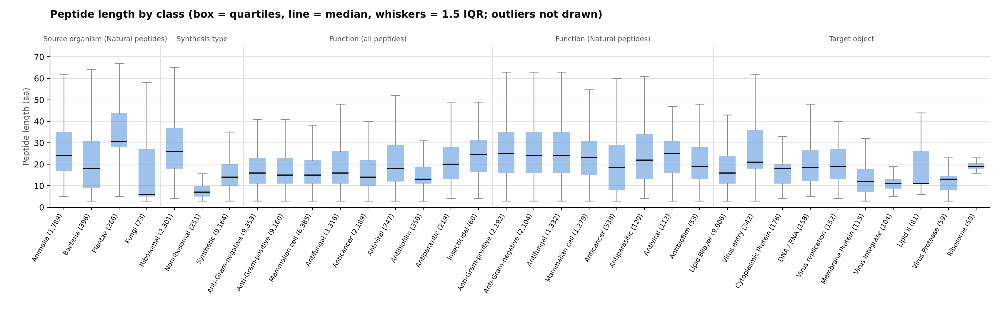
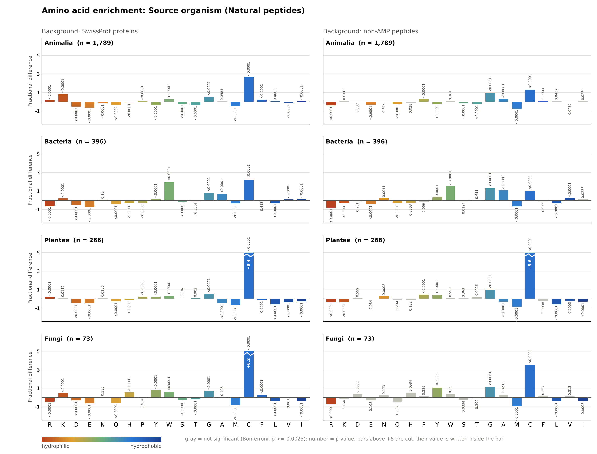
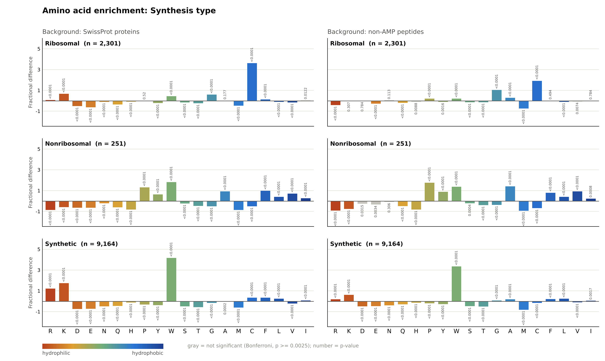
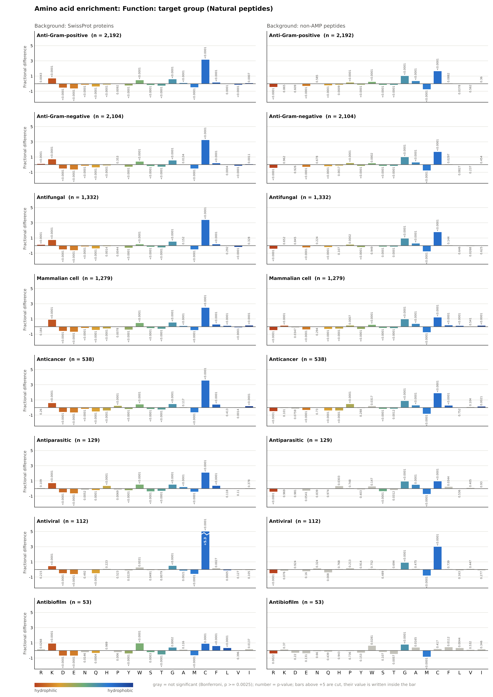
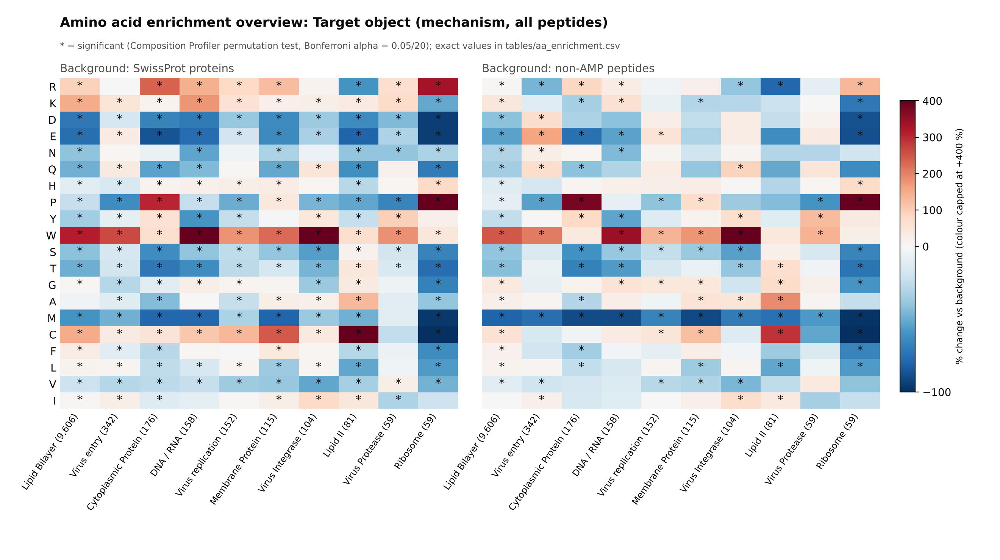

# Class comparisons: source organism, synthesis type, function and target object

The Natural vs Synthetic figures of [`../deliverables/`](../deliverables/README.md), made for every other classification of the peptides.
Same peptides (the 11,716 of the deliverables: cleaned, `X` -> Ala, 3-100 aa, CD-HIT 90 % with Natural and Synthetic clustered together),
same figure designs, same Composition Profiler test (official tool, v2.0) and the same two backgrounds (SwissProt proteins, non-AMP peptides).
All class labels are existing DBAASP columns; nothing new is calculated.

```
class_comparisons/
  scripts/        common.py                    paths, comparisons, classes, style
                  01_build_class_table.py      labels for every peptide, class sizes, per-class FASTA, overlap tables
                  02_length_figures.py         length figures + tables (summary, categories, tests)
                  03_aa_enrichment.py          Composition Profiler, every class x 2 backgrounds (about 30 min)
                  04_enrichment_figures.py     enrichment figures + overview figures
                  05_annotation_shares.py      terminal modifications, D-amino acids, former X, tested targets per class
  overview/       tables/class_peptides.csv    every peptide with its labels (TG_* = target group, TO_* = target object)
                  tables/class_sizes.csv       every class of every comparison, n, tested yes/no
                  tables/annotation_shares.csv, annotation_tests_natural_vs_synthetic.csv, former_x_share_by_class.csv
                  tables/function_overlap_jaccard.csv, target_object_overlap_jaccard.csv
                  figures/length_boxplots.png  length of every tested class side by side
                  figures/function_overlap.png, target_object_overlap.png
  <comparison>/   source_organism  synthesis_type  function_all  function_natural  target_object
      fasta/<class>.fasta                         the peptides of the class (same headers and sequences as deliverables/fasta)
      figures/length_histogram_overlap.png        one panel per class: class (blue) vs whole population (gray), % of the group, medians
      figures/length_histogram_overlap_counts.png the same as counts
      figures/length_category_fraction_bar.png    share of every class in the four length categories (first bar = population)
      figures/amino_acid_enrichment.png           one row per class x two backgrounds; same design as the deliverables figure
      figures/enrichment_heatmap.png              the same numbers as a compact heatmap (* = significant)
      tables/length_summary.csv  length_category_fractions.csv  length_tests.csv  aa_enrichment.csv
```

Run, after the deliverables: `python class_comparisons/scripts/01_build_class_table.py` ... `05_annotation_shares.py` (in order).

## The five comparisons

| Folder | Classes (n >= 50 are drawn and tested) | Not tested (n < 50) | Population (gray in the figures) |
|---|---|---|---|
| `source_organism` | Animalia 1,789 · Bacteria 396 · Plantae 266 · Fungi 73 | Unclassified 21 · Archaea 3 · Protista 2 · two kingdoms 2 | Natural peptides (2,552) |
| `synthesis_type` | Ribosomal 2,301 · Nonribosomal 251 · Synthetic 9,164 | | all peptides (11,716) |
| `function_all` | anti-Gram-neg 9,353 · anti-Gram-pos 9,160 · mammalian cell 6,385 · antifungal 3,316 · anticancer 2,189 · antiviral 747 · antibiofilm 356 · antiparasitic 219 · insecticidal 60 | antiprotozoal 33 · nematicidal 28 · anti-mollicute 18 | all peptides |
| `function_natural` | anti-Gram-pos 2,192 · anti-Gram-neg 2,104 · antifungal 1,332 · mammalian cell 1,279 · anticancer 538 · antiparasitic 129 · antiviral 112 · antibiofilm 53 | insecticidal 37 · antiprotozoal 31 · nematicidal 26 · anti-mollicute 11 | Natural peptides |
| `target_object` | lipid bilayer 9,606 · virus entry 342 · cytoplasmic protein 176 · DNA/RNA 158 · virus replication 152 · membrane protein 115 · virus integrase 104 · Lipid II 81 · virus protease 59 · ribosome 59 | 14 smaller objects (gp41 41, immunomodulation 41, ...) | all peptides |

Things that shape how to read them:
* **Kingdom exists only for Natural peptides** (DBAASP marks the synthetic ones as unclassified), so `source_organism` compares Natural peptides only.
* **Function and target-object classes overlap.** A peptide has a median of 3 target groups; anti-Gram-negative and anti-Gram-positive share most
  of their peptides (Jaccard 0.83, `overview/figures/function_overlap.png`). The classes are not independent samples.
* **Synthetic peptides are 78 % of the data**, so `function_all` and `target_object` mostly show the synthetic composition; `function_natural`
  is the fairer view of function.
* **A target group means "activity was measured against it"**, not "the peptide is potent against it"; "mammalian cell" is mostly hemolysis/cytotoxicity testing.
* **Lipid II** is not one of the 23 target objects extracted by the notebook (so the raw subsets have no `Lipid_II.csv`); it is added here (81 peptides).
  1,245 peptides have no target object and 77 only "Unknown".
* **`X` -> Ala inflates Alanine** most in nonribosomal peptides (10.4 % of their residues were `X`), Lipid II peptides (9.9 %), membrane-protein (5.4 %),
  ribosome (4.0 %) and bacterial peptides (3.8 %); elsewhere it is 0-1.7 % (`overview/tables/former_x_share_by_class.csv`). In those classes the Ala bar is not a finding.

## Length



| Comparison | Medians (aa) | Strongest differences (rank-biserial r vs the rest of the population) |
|---|---|---|
| Source organism | Plantae 30.5 · Animalia 24 · Bacteria 18 · **Fungi 6** | Fungi -0.51 (71 % are 3-9 aa), Bacteria -0.27, Plantae +0.27 (70 % are 25-50 aa); Kruskal-Wallis p = 1e-36 |
| Synthesis type | Ribosomal 26 · Synthetic 14 · **Nonribosomal 7** | Nonribosomal -0.74 (none longer than 22 aa), Ribosomal +0.59; Kruskal-Wallis p < 1e-300 |
| Function, all | 13-18 for most; antiparasitic 20, insecticidal 24.5 | insecticidal +0.35, antiparasitic +0.21; the rest within +-0.13 |
| Function, Natural | 18.5-25 | **anticancer -0.30** (median 18.5 vs 25), mammalian cell -0.14; antifungal, antiviral, antiparasitic, antibiofilm not different after correction |
| Target object | virus entry 21 · ribosome 19 · DNA/RNA 18.5 · lipid bilayer 16 · virus integrase 11 · Lipid II 11 | virus entry +0.41, virus integrase -0.36, ribosome +0.32 (83 % are 10-24 aa), membrane protein -0.28, virus protease -0.29 |

Per-comparison figures: `<comparison>/figures/length_histogram_overlap.png` and `length_category_fraction_bar.png`; numbers in `<comparison>/tables/`.

## Amino acid enrichment

Read every result against **both** backgrounds: SwissProt answers "different from ordinary proteins?", the non-AMP peptides
(themselves rich in Lys and Arg) answer "different from other short peptides?". Bar = fractional difference, gray = not significant
(Bonferroni over 20 amino acids). Numbers below are % change; all are significant unless marked ns. Full tables: `<comparison>/tables/aa_enrichment.csv`.

### Source organism (Natural peptides)



| % change vs SwissProt (vs non-AMP) | Cys | Gly | Trp | Lys | Arg | Met |
|---|---|---|---|---|---|---|
| Animalia (1,789) | +264 (+131) | +52 (+95) | +24 (+5 ns) | +81 (+6 ns) | +13 (-39) | -48 (-75) |
| Bacteria (396) | +220 (+103) | +82 (+132) | **+199 (+152)** | +20 (-29) | -62 (-79) | -32 (-67) |
| Plantae (266) | **+937 (+557)** | +55 (+98) | +27 (+7 ns) | +9 ns (-36) | +20 (-35) | -66 (-84) |
| Fungi (73) | **+616 (+354)** | +67 (+114) | +60 (+34 ns) | +43 (-16 ns) | -44 (-70) | -82 (-91) |

* **One natural signature in every kingdom: Cys and Gly up, Met (and Glu, Gln) down**, against both backgrounds. Plants and fungi are by far the most
  Cys-rich (disulfide-stabilised thionins, defensins, cyclotides).
* **Bacteria** add Trp (+199 %) and Ala (+65 %, partly former `X`: 3.8 % of their residues) and lose Arg. **Plantae** lose the hydrophobic Leu, Ala, Ile, Val, Met
  and gain Pro, Tyr. **Fungi** (n = 73, indicative) gain Tyr (+79 %) and His.
* Against non-AMP peptides the natural classes are not cationic: Arg is depleted in all four and Lys is not enriched.

### Synthesis type



* **Ribosomal** peptides carry the natural signature: Cys +361 % (+192 % vs non-AMP), Gly +59 % (+104 %), Lys +67 % (vs non-AMP -2 % ns).
* **Nonribosomal** peptides are a class of their own: Pro +131 % (+175 %), Trp +181 % (+137 %), Phe +99 %, Val +71 %, Tyr +63 %; Arg -87 %, Lys -60 %, Met -87 %, Cys -51 %, His.
  Their Ala +93 % is **not** a finding: 10.4 % of their residues were `X` (ornithine, D-/modified residues) and became Ala.
* **Synthetic** peptides: Trp +417 % (+335 %), Lys +174 % (+61 %), Arg +121 % (+19 %), little Cys (+33 %, -16 % vs non-AMP): the designed cationic, Trp-rich pattern.
  (This row is identical to `deliverables/tables/aa_enrichment.csv`, which the script checks.)

### Function (target group)



* **All peptides** (`function_all/`): every class shows the synthetic pattern, Trp (+64 to +405 %), Lys (+62 to +210 %) and Cys up, Glu, Asp, Met, Thr, Gln down.
  **Antiviral** is the exception: Glu (+3 % ns) and Gln (+16 %) are not depleted (vs non-AMP Glu +97 %, Asp +39 %), Pro is down (-51 %) and Lys is only +62 % (-5 % ns vs non-AMP);
  many antiviral peptides are derived from viral fusion proteins (see target object below).
* **Natural only** (`function_natural/`): all classes share the natural signature (Cys +88 to +531 %, Gly +38 to +58 %, Met, Glu down), so **within natural peptides
  composition follows source much more than function.** Smaller differences: antiviral natural peptides are the most Cys-rich (+531 %); peptides tested on mammalian cells
  have more Lys (+89 %) and Trp (+47 %); anticancer peptides more Pro (+21 %, +45 % vs non-AMP), Phe (+39 %) and Ile and less His (-38 %); antibiofilm peptides (n = 53)
  the weakest Cys signal (+88 %, ns vs non-AMP).

### Target object (mechanism)



* **Ribosome** (59) and **cytoplasmic protein** (176) targeting peptides are **Pro/Arg-rich and Cys-free**: Ribosome Pro +625 % (+764 % vs non-AMP), Arg +333 %,
  Cys -100 % (none), His +77 %; cytoplasmic protein Pro +303 %, Arg +237 %, Tyr +57 %. This is the proline-rich AMP family (e.g. apidaecin, oncocin, Bac7) that enters
  bacteria and binds the ribosome or DnaK, rather than lysing the membrane.
* **Lipid II** (81): Cys +514 %, Thr +47 %, Ile +44 %, Ser +16 %; Arg -59 %, Pro -52 %, Leu -52 %. Its Ala +130 % is mostly former `X` (9.9 % of its residues; lanthionine
  and other modified residues of lantibiotics). Consistent with lantibiotics and defensin-like Lipid II binders.
* **Virus entry** (342): Trp +265 %, but **Glu +34 % and Gln +37 %** (vs non-AMP Glu +156 %, Asp +69 %), Pro -62 %, Arg unchanged:
  anionic, fusion-protein-derived peptides (e.g. gp41-derived inhibitors), unlike the cationic membrane-active AMPs.
  **Virus replication** (152) goes the same way more weakly (Glu -19 % vs SwissProt but +55 % vs non-AMP; Trp +180 %).
* **Virus integrase** (104): Trp +543 %, Ile +76 %, Gln +50 %; short (median 11 aa).
* **DNA/RNA** (158): Trp +425 %, Lys +175 %, Arg +142 % (cationic, Trp-rich; e.g. indolicidin- and buforin-like peptides).
* **Lipid bilayer** (9,606, 82 % of all peptides) simply reproduces the overall AMP pattern (Trp +314 %, Lys +149 %, Arg +92 %, Cys +149 %).

### What the comparisons add to Natural vs Synthetic

1. The natural Cys/Gly signature belongs to **ribosomal** peptides and is strongest in **plants and fungi**; nonribosomal peptides are short, Pro/aromatic-rich and not cationic.
2. Within natural peptides, **target group hardly changes composition**; source does.
3. **Mechanism does**: intracellular (ribosome, DnaK) binders are Pro/Arg-rich and Cys-free, viral-entry peptides are anionic, membrane-active peptides follow the cationic pattern.

## Other annotations per class (`overview/tables/annotation_shares.csv`)

| | Natural | Synthetic | Ribosomal | Nonribosomal | Animalia | Bacteria | Plantae | Fungi |
|---|---|---|---|---|---|---|---|---|
| C-terminus modified | 22.8 % | **49.6 %** | 24.4 % | 8.4 % | 31.2 % | 3.3 % | 0 % | 1.4 % |
| N-terminus modified | 5.4 % | 7.7 % | 2.0 % | **36.7 %** | 1.0 % | 22.2 % | 0.4 % | 30.1 % |
| contains a D-amino acid | 5.6 % | 8.0 % | 0.5 % | **52.2 %** | 0.4 % | 24.5 % | 0.4 % | 47.9 % |
| contained `X` | 10.3 % | 9.9 % | 5.6 % | **52.6 %** | 3.2 % | 39.9 % | 7.9 % | 27.4 % |
| tested vs fungi | **52.2 %** | 21.6 % | 53.1 % | 43.8 % | 58.5 % | 26.3 % | 50.8 % | 49.3 % |
| tested vs mammalian cells | 50.1 % | 55.7 % | 52.7 % | 26.7 % | 59.1 % | 25.5 % | 33.5 % | 27.4 % |

Natural vs Synthetic (chi-square, `annotation_tests_natural_vs_synthetic.csv`): C-terminal modification (mostly amidation) 23 % vs 50 % (p ~ 1e-128) and antifungal testing
52 % vs 22 % (p ~ 1e-201) are the large differences. D-amino acids, N-terminal modification and non-standard residues are concentrated in **nonribosomal** peptides,
which is why bacterial and fungal peptides (many of them nonribosomal products) carry them.
