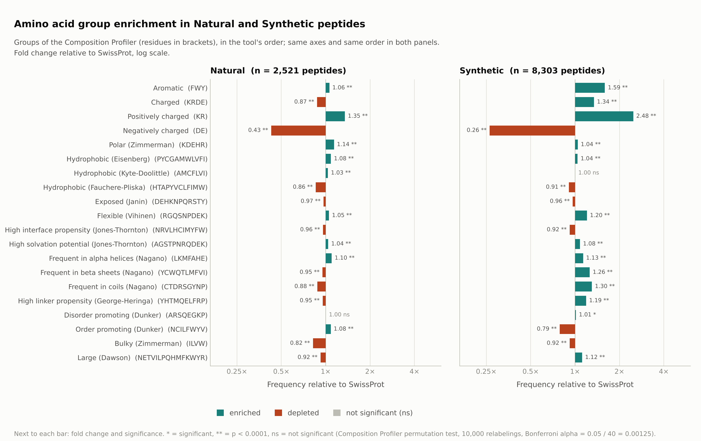

# Deliverables: DBAASP peptides after cleaning and CD-HIT, 90 % identity (Natural + Synthetic)

One FASTA of all Natural and Synthetic peptides after cleaning (X handling, minimum length) and CD-HIT at 90 % identity, the exact
count of sequences lost on the way, the length figures, and the amino acid enrichment of the two datasets against SwissProt.
Everything here is rebuilt from `../raw_data/dbaasp_datasets_corrected.zip` by the five scripts in `scripts/`. Nothing outside
this folder is read or changed except that zip (and, for steps 4 and 5, the installed `cprofiler` package).

```
deliverables/
  fasta/amp_cdhit90.fasta                 10,824 peptides (Natural + Synthetic), ">DBAASP_<ID>" + one-line upper-case sequence
  fasta/amp_natural_cdhit90.fasta         the 2,521 Natural peptides of that file
  fasta/amp_synthetic_cdhit90.fasta       the 8,303 Synthetic peptides of that file
  figures/length_histogram_overlap.png         overlapping histograms + smooth lines: entire / Natural / Synthetic (each as % of its group)
  figures/length_histogram_overlap_counts.png  the same with peptide counts
  figures/length_category_fraction_bar.png     share of Natural and Synthetic peptides per length category
  figures/amino_acid_enrichment.png            the 20 amino acids, Natural and Synthetic in ONE image (same axes, same order, significance marks)
  figures/amino_acid_group_enrichment.png      the 20 amino acid groups of the Composition Profiler, the same way
  tables/redundancy_removal_summary.csv   step-by-step counts, Natural / Synthetic / Total
  tables/removed_records.csv              every lost record: why, and which kept peptide covers it (+ identity for CD-HIT)
  tables/x_to_alanine_counts.csv          peptides and residues in which X was changed to Alanine
  tables/peptide_metadata.csv             FASTA ID -> origin, length, length category, sequence
  tables/length_summary.csv               numbers behind the histogram
  tables/length_category_fractions.csv    numbers behind the bar chart
  tables/cdhit_checks.csv                 integrity checks and two what-if runs (section 5)
  tables/aa_enrichment_natural_vs_synthetic.csv   all 40 tests: frequencies, effect, fold change, p-value, result, both datasets
  tables/aa_enrichment_background_check.csv       the same effects with AMP-named proteins removed from the background
  background/swissprot51_5k.fasta         SwissProt background, 5,002 proteins (identical to the tool's own `-D sprot` file)
  cdhit/                                  CD-HIT input, output, cluster file (.clstr) and log
  scripts/01_remove_redundancy.py  02_make_figures.py  03_check_cdhit_result.py  04_aa_enrichment.py  05_enrichment_figures.py
```

## 0. What changed in this version

* **`X` (non-standard residue)** is no longer kept. Per peptide: if `X` is **30 % or more** of the peptide it is removed (1,214 peptides); below
  that every `X` becomes **Alanine** (2,610 peptides, 4,494 residues, `tables/x_to_alanine_counts.csv`). Peptides made only of `X` were already removed.
  The 30 % cutoff is my choice (`X_MAX_FRACTION` in script 01); the alternative of converting all `X` would keep peptides that are up to 89 % `X`.
* **Minimum length:** a peptide needs at least **3 real (non-`X`) amino acids** (`MIN_REAL`); 775 peptides fall below it, including the
  15 single-residue entries. The check runs before `X` becomes Ala.
* Duplicates are searched **after** `X` -> Ala, because the change can make two peptides identical.
* Amino acid figures: Natural and Synthetic share one image, identical axes, scale and amino acid order (hydrophilic -> hydrophobic),
  colour-coded, with the Composition Profiler's significance marked (section 3).

## 1. Sequences lost

**CD-HIT (>= 90 % identity) removed 6,615 sequences** (760 Natural, 5,855 Synthetic) of the 15,289 it was given (43.3 %).
Counted from the raw DBAASP export, **14,718 of 25,542 rows are lost, 10,824 remain.**

| Step | what is removed | Natural | Synthetic | **Total lost** | left |
|---|---|---|---|---|---|
| 0 | raw rows | | | | 25,542 |
| 1 | exact duplicate row (same entry, same ID, twice) | 406 | 1,594 | 2,000 | 23,542 |
| 2 | multi-chain entry (several chains in one cell, length not reliable) | 97 | 538 | 635 | 22,907 |
| 3 | sequence made only of `X` | 27 | 321 | 348 | 22,559 |
| 4 | **fewer than 3 real (non-`X`) amino acids** | 197 | 578 | 775 | 21,784 |
| 5 | **`X` is >= 30 % of the peptide** | 261 | 953 | 1,214 | 20,570 |
| | (remaining `X` -> Ala: 331 Natural + 2,279 Synthetic peptides, no loss) | | | | |
| 6 | duplicate sequence within the same origin (after X -> Ala) | 224 | 2,786 | 3,010 | 17,560 |
| 7 | same sequence in Natural and in Synthetic (Natural entry kept) | 0 | 121 | 121 | 17,439 |
| 8 | **CD-HIT, >= 90 % identity** | **760** | **5,855** | **6,615** | **10,824** |
| | **final** | **2,521** | **8,303** | | |

Steps 1 to 3 and 6 are the existing cleaning of `scripts/01_clean_datasets.py`. Step 1 removes repeated rows of the same entry, so it is not a
loss of distinct peptides: of the 23,542 distinct entries, 12,718 are lost. Because the new steps 4 and 5 run before the duplicate search,
the duplicate steps find fewer duplicates than before (3,010 + 121 instead of 3,853 + 167), because many duplicates were already removed with the
`X` and short peptides. Step counts are therefore not comparable one to one with the previous version (which kept 11,804).

CD-HIT arithmetic: 17,439 peptides enter step 8. 2,150 of them are shorter than 10 aa and skip CD-HIT (section 4).
The other 15,289 go in, 8,674 representatives come out, 6,615 are removed. 8,674 + 2,150 = 10,824.

## 2. Length figures


| | Natural | Synthetic | Entire |
|---|---|---|---|
| n | 2,521 | 8,303 | 10,824 |
| median / mean length (aa) | 24 / 27.5 | 14 / 16.1 | 16 / 18.8 |
| Q1 to Q3 | 15 to 35 | 10 to 20 | 11 to 23 |

| Share of group in category | Natural | Synthetic |
|---|---|---|
| Ultrashort 3-9 aa | 11.2 % | 22.5 % |
| Short 10-24 aa | 38.8 % | **63.7 %** |
| Medium 25-50 aa | **42.6 %** | 13.2 % |
| Long 51-100 aa | 6.7 % | 0.6 % |
| > 100 aa | 0.7 % | 0.02 % |

No peptide is shorter than 3 aa any more (so the "1 aa" and "2 aa" categories are empty and no longer drawn). Natural peptides are longer
(median 24 vs 14 aa) and make up most of the Long (170 of 217) and > 100 aa (17 of 19) peptides. Synthetic peptides sit mostly in the Short class.
The Synthetic histogram has sharp spikes (e.g. 659 peptides at 12 aa, 504 at 20 aa but 260 at 19 aa; also 9, 13 and 18 aa), probably convenient design lengths.
The length figures carry no significance marks (the Composition Profiler gives p-values for composition only).

## 3. Amino acid enrichment vs SwissProt

How much more or less often each amino acid occurs in the Natural and in the Synthetic peptides than in typical proteins
(background = SwissProt). Both datasets are in one image, with the same axes, the same scale and the same amino acid order.


**Method** (`scripts/04_aa_enrichment.py` computes, `scripts/05_enrichment_figures.py` draws; the same tool, functions and settings as `scripts/06_run_composition_profiler.py` of the main analysis)
* Tool: the official Composition Profiler, https://github.com/vvacic/cprofiler (v2.0).
* Queries: `fasta/amp_natural_cdhit90.fasta` (2,521 peptides, 69,411 residues) and `fasta/amp_synthetic_cdhit90.fasta`
  (8,303 peptides, 133,978 residues), i.e. the CD-HIT 90 % datasets of this folder. They contain no `X` any more.
* Background, the same for both: `background/swissprot51_5k.fasta`, 5,002 randomly sampled SwissProt proteins (release 51,
  1,799,466 residues). It is the file the tool ships as `-D sprot` (checked byte for byte).
* Effect = (frequency in the peptides - frequency in SwissProt) / frequency in SwissProt, residues pooled over all sequences.
  The tables and figures use the **fold change = 1 + effect** (2.77 means 2.77 times as frequent as in SwissProt).
* p-value: 10,000 random relabelings of whole sequences between peptides and background, two-tailed, so the smallest value is
  1 / 10,000 (a 0 in the table means p < 0.0001). Significant = p < 0.05 / 40 = 0.00125 (Bonferroni, 20 amino acids + 20 groups).
  The seed is fixed, so a re-run gives the same table.

**How the figures are built (so that they can be compared)**
* Same x axis in both panels: the amino acids in the Composition Profiler's own hydrophobicity order (Kyte-Doolittle, `-X hydrophobicity_kyte`),
  from hydrophilic (R) to hydrophobic (I). Same y axis in both panels: fold change on one log scale, 0.16x to 9.8x.
* Bars are colour-coded along that order (red = hydrophilic ... dark blue = hydrophobic). **Gray bars are not significant.**
* Marks next to every bar: `*` significant (p < 0.00125 after Bonferroni), `**` p < 0.0001 (no random relabeling reached the observed
  effect, the smallest value 10,000 iterations can give), `ns` not significant. The numbers are the Composition Profiler's own call.
* The group figure uses the same two-panel layout, the tool's group order in both panels, and colours enriched (teal), depleted (rust), not significant (gray).

**Single amino acids** (fold change vs SwissProt; `tables/aa_enrichment_natural_vs_synthetic.csv` also has the frequencies, effects and p-values)

| Amino acid | in SwissProt (% of residues) | Natural | Natural result | Synthetic | Synthetic result |
|---|---|---|---|---|---|
| A | 7.91 | 1.04 | Not significant | 0.96 | Depleted |
| C | 1.50 | 4.45 | Enriched | 1.34 | Enriched |
| D | 5.36 | 0.48 | Depleted | 0.25 | Depleted |
| E | 6.68 | 0.38 | Depleted | 0.27 | Depleted |
| F | 3.98 | 1.14 | Enriched | 1.34 | Enriched |
| G | 6.97 | 1.57 | Enriched | 0.83 | Depleted |
| H | 2.30 | 0.90 | Depleted | 0.87 | Depleted |
| I | 5.98 | 1.03 | Not significant | 1.07 | Enriched |
| K | 5.96 | 1.62 | Enriched | 2.77 | Enriched |
| L | 9.71 | 0.91 | Depleted | 1.25 | Enriched |
| M | 2.39 | 0.52 | Depleted | 0.39 | Depleted |
| N | 4.12 | 0.89 | Depleted | 0.51 | Depleted |
| P | 4.77 | 1.05 | Enriched | 0.68 | Depleted |
| Q | 3.91 | 0.64 | Depleted | 0.54 | Depleted |
| R | 5.45 | 1.05 | Enriched | 2.17 | Enriched |
| S | 6.74 | 0.84 | Depleted | 0.51 | Depleted |
| T | 5.32 | 0.76 | Depleted | 0.44 | Depleted |
| V | 6.76 | 0.86 | Depleted | 0.80 | Depleted |
| W | 1.15 | 1.44 | Enriched | 5.01 | Enriched |
| Y | 3.06 | 0.81 | Depleted | 0.64 | Depleted |

**Amino acid groups** (selection; all 20 groups are in `figures/amino_acid_group_enrichment.png` and the csv)

| Group | Residues | Natural | Natural result | Synthetic | Synthetic result |
|---|---|---|---|---|---|
| Positively charged | KR | 1.35 | Enriched | 2.48 | Enriched |
| Negatively charged | DE | 0.43 | Depleted | 0.26 | Depleted |
| Charged | KRDE | 0.87 | Depleted | 1.34 | Enriched |
| Aromatic | FWY | 1.06 | Enriched | 1.59 | Enriched |
| Hydrophobic (Eisenberg) | PYCGAMWLVFI | 1.08 | Enriched | 1.04 | Enriched |
| Hydrophobic (Kyte-Doolittle) | AMCFLVI | 1.03 | Enriched | 1.00 | Not significant |
| Hydrophobic (Fauchere-Pliska) | HTAPYVCLFIMW | 0.86 | Depleted | 0.91 | Depleted |
| Order promoting (Dunker) | NCILFWYV | 1.08 | Enriched | 0.79 | Depleted |



**What it shows**
* **Both datasets look like antimicrobial peptides: rich in K, R and W, poor in D and E.** The positively charged group is x1.35 (Natural)
  and x2.48 (Synthetic), the negatively charged group x0.43 and x0.26. D and E are among the most depleted residues in both.
* **Synthetic peptides push this recipe much further:** Trp x5.01 (5.74 % of all residues against 1.15 % in SwissProt), Lys x2.77 (16.5 %),
  Arg x2.17. Natural peptides: Lys x1.62, Trp x1.44, and Arg x1.05, which is hardly a change.
* **Natural peptides are marked by Cys and Gly:** Cys x4.45 (6.7 % of residues against 1.5 %), consistent with disulfide-rich peptides
  such as defensins, and Gly x1.57. In Synthetic, Cys is x1.34 and Gly x0.83.
* **The two datasets go in opposite directions for** Gly (x1.57 vs x0.83), Leu (x0.91 vs x1.25), Pro (x1.05 vs x0.68), the group "Charged"
  (x0.87 vs x1.34) and "Order promoting" (x1.08 vs x0.79). These differences say something about origin; the shared K/R/W/D/E pattern
  says something about antimicrobial peptides in general.
* **No consistent hydrophobicity shift:** the three hydrophobicity scales disagree (Eisenberg x1.08 / x1.04, Kyte-Doolittle x1.03 / x1.00,
  Fauchere-Pliska x0.86 / x0.91).
* **Read the size of the fold change, not the p-value.** With thousands of peptides almost everything is significant. Not significant after
  Bonferroni: A and I in Natural, the group Disorder promoting (Dunker) in Natural and the Kyte-Doolittle hydrophobic group in Synthetic. R and P in Natural
  and A in Synthetic are only just significant (`*`, p between 0.0002 and 0.0006). As a rule of thumb (my choice, not the tool's), a fold change within 0.9 to 1.1 is negligible.
* Close to the previous version of this folder (Synthetic Trp x5.03, Lys x2.82, Natural Cys x4.43): the X and length changes did not alter the picture.

**Limits**
* **`X` became Ala in some peptides, which inflates Alanine.** 0.8 % of the Natural and 2.9 % of the Synthetic residues are Ala only because they were `X`.
  The Synthetic Ala frequency of 7.56 % therefore contains 2.9 percentage points of converted `X`; without them Ala would be clearly depleted (about x0.6). Read the Ala bars with this in mind.
  The other 19 amino acids are slightly diluted by the same amount.
* **SwissProt is a background of normal, mostly long proteins** (mean about 360 aa), the queries are short peptides. "Enriched" means
  "different from a typical protein", not "different from a random peptide".
* **The background is old and small** (release 51, a 5,002-protein sample, no current UniProt download was possible in the original
  environment). To repeat it with a current file, replace `background/swissprot51_5k.fasta`.
* **Is the background non-AMP?** SwissProt is not filtered for AMPs. A screen of the protein names finds 12 of the 5,002 proteins with an AMP-type
  name (defensins, cecropins, dermaseptin, hepcidin ...). Without them no effect changes by more than 0.006 and no test result changes
  (`tables/aa_enrichment_background_check.csv`). The screen is by name only, so an AMP with an uninformative name would not be found.
* Residues are pooled, so long peptides weigh more than short ones, and Natural and Synthetic differ in length; there is no length adjustment.
  D-amino acids count as their L form (the FASTA is upper case).
* The tool's group names contain two typos ("propencity", "potenential"): kept in the csv, corrected in the figure.

## 4. Method (CD-HIT)

```
cd-hit -i input_ge10aa.fasta -o cdhit_ge10aa.fasta -c 0.9 -n 5 -d 0 -l 9 -M 0 -T 1
```
* `-c 0.9 -n 5`: 90 % identity, word size 5, as in the rest of the repository. cd-hit keeps the longest peptide of each cluster.
* **Natural and Synthetic are clustered together**, so the 90 % cut-off applies across both groups, not within each one. When the same sequence
  is in both groups, the Natural entry is kept.
* **Peptides shorter than 10 aa are not sent to CD-HIT**, the existing rule of `scripts/02_run_cdhit.py`.
* **`-l 9` matters.** cd-hit's default `-l 10` silently discards every sequence of 10 aa or fewer. The script checks that
  cd-hit read exactly as many sequences as it was sent (15,289), and stops if not.
* `-T 1`: one thread, so the result is reproducible. The output is byte-identical on re-run.
* FASTA headers use the DBAASP ID (`>DBAASP_11`), not a running number, so every entry can be traced back to the database.
  Sequences are upper case (D-amino acids are lower case in the csv files); `X` no longer occurs (removed or changed to Ala, section 0).
  Origin is not in the header: use the two per-origin files (same records, same headers, same order as the combined file)
  or `tables/peptide_metadata.csv`.

## 5. Things to know

1. **The earlier CD-HIT step undercounts 10-aa peptides.** `scripts/02_run_cdhit.py` sent peptides >= 10 aa to cd-hit with the
   default `-l 10`, which discards 10-aa sequences. `cdhit/by_origin/*/cdhit.log` shows it: Natural "total seq: 3012" although 3,099
   were sent, Synthetic 12,029 of 12,818. So 87 + 789 = 876 ten-aa peptides were dropped and counted as "removed by CD-HIT"
   (section 4 of the main README: 775 / 6,042 removed, 2,797 / 9,092 kept). Clustered per origin with the fix, the result would be
   2,881 / 9,665. These deliverables do not have the problem. The existing scripts, tables and analyses were left as they were.
2. **Combined vs separate clustering.** Clustering together removed 1,673 Synthetic peptides because a Natural peptide covers
   them, and 132 Natural ones because a Synthetic peptide does. Clustering each origin on its own (the old way) would keep
   11,503 peptides (2,611 / 8,892) but the FASTA would still hold Natural/Synthetic near-duplicates. The medians do not change
   (Natural 24, Synthetic 14 either way), so the length conclusions do not depend on this choice.
3. **CD-HIT is greedy**, so which peptide is kept depends a little on the input order (in a test on the previous version of the dataset, a different input order moved the
   separate-clustering numbers by 3 and 6 peptides). The deliverable numbers are for the input order of script 01 and are reproducible.
4. **Peptides of 5-9 aa are not clustered.** Two different peptides of up to 9 aa cannot be 90 % identical, but a short peptide
   can be an exact fragment of a longer one. If the 5-9 aa peptides are clustered too (cd-hit cannot read anything under 5 aa),
   **456 more are removed** (448 Synthetic, 8 Natural), leaving 10,368. The final FASTA has 1,929 peptides of 5-9 aa,
   221 of 3-4 aa and none shorter.
5. **No peptide is shorter than 3 aa** in the final set (the 15 single-amino-acid entries of the earlier version and all 2-aa peptides
   with fewer than 3 real residues are gone, step 4). Peptides of 3-9 aa are kept; the "Ultrashort" class is therefore 3-9 aa here.
6. **Length categories** follow the `Length_Class` column of the data (all 10,824 agree). The data labels the class "Long (50-100 aa)", but
   50-aa peptides are in Medium; Long is 51-100 aa and is labelled so here.
7. **The histogram axis stops at 100 aa**; the 19 longer peptides (17 Natural, 2 Synthetic, longest 190 aa) are named in the
   figure footnote and are in the tables. The overlapping histograms are scaled to 100 % of their own group, because Natural
   (2,521) is much smaller than Synthetic (8,303); the counts version is `length_histogram_overlap_counts.png`.
   The smooth lines are a Gaussian kernel density with a 3 aa bandwidth, mirrored at the 1 aa edge, using all peptides
   (also those over 100 aa). Each line has an area of 100 %, so it is on the same scale as the bars. The wider the
   bandwidth, the more the design-length spikes are averaged out; the bars underneath still show them.

## 6. Reproduce

```bash
pip install pandas matplotlib numpy
sudo apt-get install cd-hit                 # or: conda install -c bioconda cd-hit   (tested with 4.8.1)
git clone https://github.com/vvacic/cprofiler && pip install -e cprofiler     # -e is required (the data folder is not shipped otherwise)
python deliverables/scripts/01_remove_redundancy.py
python deliverables/scripts/02_make_figures.py
python deliverables/scripts/03_check_cdhit_result.py      # optional: checks and what-ifs
python deliverables/scripts/04_aa_enrichment.py           # about 1 minute (4 x 10,000 permutations); writes the tables
python deliverables/scripts/05_enrichment_figures.py      # draws the two enrichment figures from the table
```
`tables/removed_records.csv` columns: `STEP` (as in the table above), `COVERED_BY` (kept peptide with the same or a >= 90 % identical
sequence, for steps 1, 6, 7 and 8), `IDENTITY_%` (CD-HIT only).
