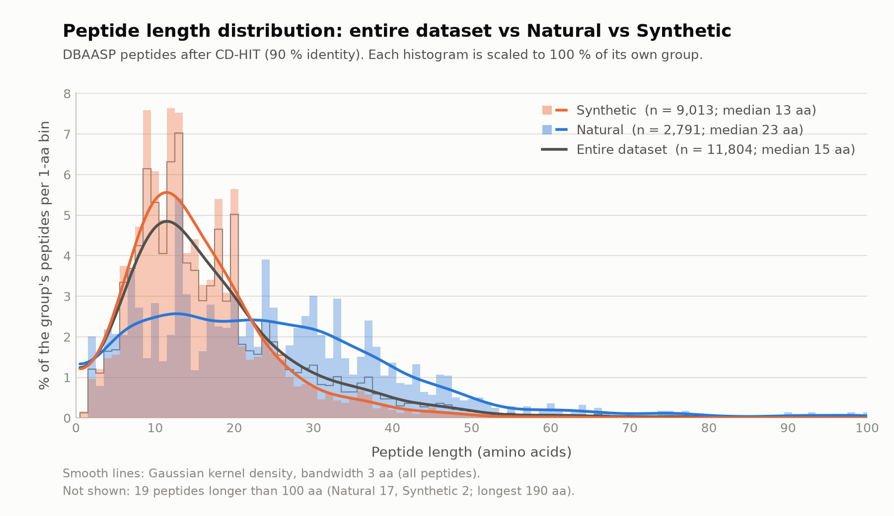
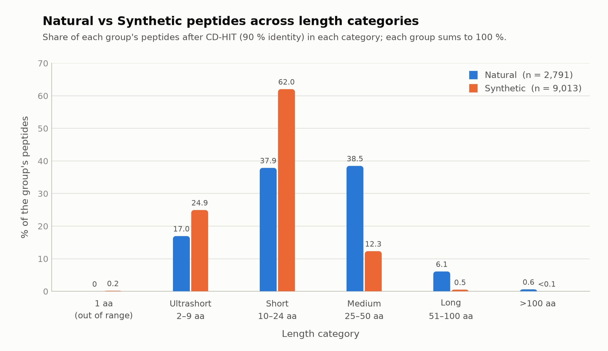
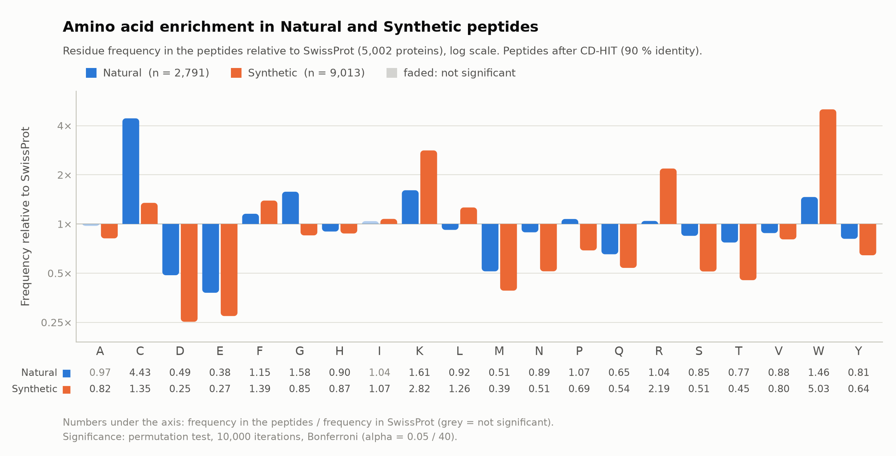
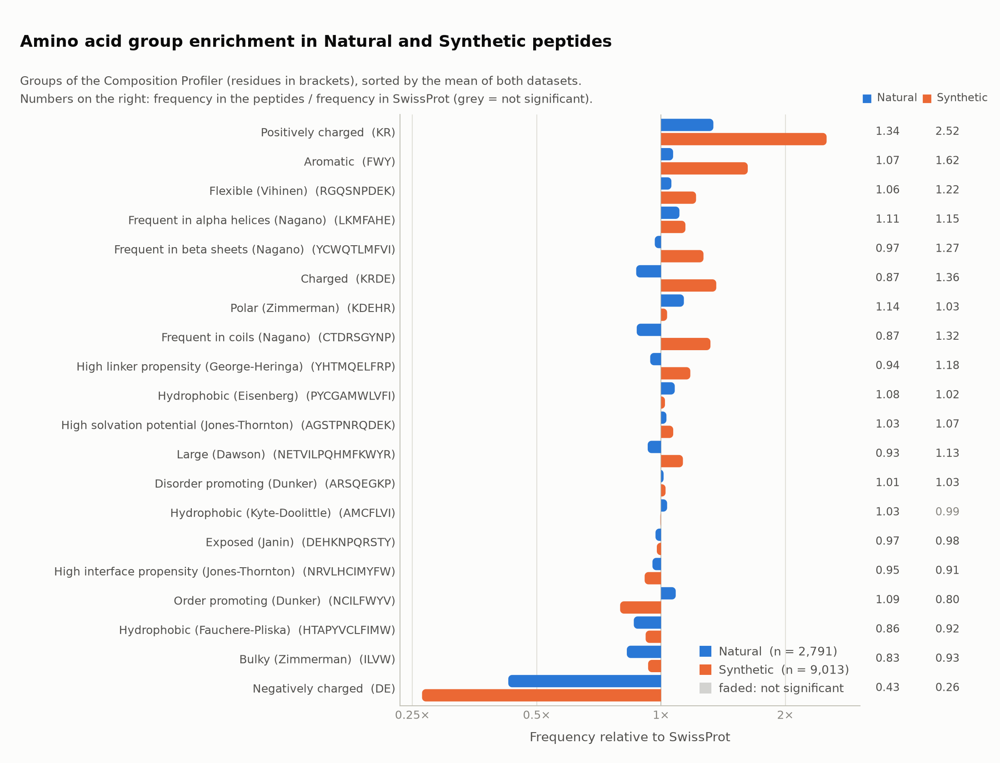

# Deliverables: DBAASP peptides after CD-HIT, 90 % identity (Natural + Synthetic)

One FASTA of all Natural and Synthetic peptides after CD-HIT at 90 % identity, the exact count of sequences lost on the
way, the length figures, and the amino acid enrichment of the two datasets against SwissProt. Everything here is rebuilt from
`../raw_data/dbaasp_datasets_corrected.zip` by the four scripts in `scripts/`. Nothing outside this folder is read or changed
except that zip (and, for step 4, the installed `cprofiler` package).

```
deliverables/
  fasta/amp_cdhit90.fasta                 11,804 peptides (Natural + Synthetic), ">DBAASP_<ID>" + one-line upper-case sequence
  fasta/amp_natural_cdhit90.fasta         the 2,791 Natural peptides of that file
  fasta/amp_synthetic_cdhit90.fasta       the 9,013 Synthetic peptides of that file
  figures/length_histogram_overlap.png         overlapping histograms + smooth lines: entire / Natural / Synthetic (each as % of its group)
  figures/length_histogram_overlap_counts.png  the same with peptide counts
  figures/length_category_fraction_bar.png     share of Natural and Synthetic peptides per length category
  figures/amino_acid_enrichment.png            the 20 amino acids, Natural and Synthetic vs SwissProt (fold change, log scale)
  figures/amino_acid_group_enrichment.png      the 20 amino acid groups of the Composition Profiler, the same way
  tables/redundancy_removal_summary.csv   step-by-step counts, Natural / Synthetic / Total
  tables/removed_records.csv              every lost record: why, and which kept peptide covers it (+ identity for CD-HIT)
  tables/peptide_metadata.csv             FASTA ID -> origin, length, length category, sequence
  tables/length_summary.csv               numbers behind the histogram
  tables/length_category_fractions.csv    numbers behind the bar chart
  tables/cdhit_checks.csv                 integrity checks and two what-if runs (section 5)
  tables/aa_enrichment_natural_vs_synthetic.csv   all 40 tests: frequencies, effect, fold change, p-value, result, both datasets
  tables/aa_enrichment_background_check.csv       the same effects with AMP-named proteins removed from the background
  background/swissprot51_5k.fasta         SwissProt background, 5,002 proteins (identical to the tool's own `-D sprot` file)
  cdhit/                                  CD-HIT input, output, cluster file (.clstr) and log
  scripts/01_remove_redundancy.py  02_make_figures.py  03_check_cdhit_result.py  04_aa_enrichment.py
```

## 1. Sequences lost

**CD-HIT (>= 90 % identity) removed 6,735 sequences** (781 Natural, 5,954 Synthetic) of the 15,803 it was given (42.6 %).
Counted from the raw DBAASP export, **13,738 of 25,542 rows are lost, 11,804 remain.**

| Step | what is removed | Natural | Synthetic | **Total lost** | left |
|---|---|---|---|---|---|
| 0 | raw rows | | | | 25,542 |
| 1 | exact duplicate row (same entry, same ID, twice) | 406 | 1,594 | 2,000 | 23,542 |
| 2 | multi-chain entry (several chains in one cell, length not reliable) | 97 | 538 | 635 | 22,907 |
| 3 | sequence made only of `X` | 27 | 321 | 348 | 22,559 |
| 4 | duplicate sequence within the same origin | 391 | 3,462 | 3,853 | 18,706 |
| 5 | same sequence in Natural and in Synthetic (Natural entry kept) | 0 | 167 | 167 | 18,539 |
| 6 | **CD-HIT, >= 90 % identity** | **781** | **5,954** | **6,735** | **11,804** |
| | **final** | **2,791** | **9,013** | | |

Steps 1 to 4 are the existing cleaning of `scripts/01_clean_datasets.py`; they reproduce the repository's cleaned
files ID for ID. Step 1 removes repeated rows of the same entry, so it is not a loss of distinct peptides: of the
23,542 distinct entries, 11,738 are lost.

CD-HIT arithmetic: 18,539 peptides enter step 6. 2,736 of them are shorter than 10 aa and skip CD-HIT (section 4).
The other 15,803 go in, 9,068 representatives come out, 6,735 are removed. 9,068 + 2,736 = 11,804.

## 2. Length figures




| | Natural | Synthetic | Entire |
|---|---|---|---|
| n | 2,791 | 9,013 | 11,804 |
| median / mean length (aa) | 23 / 25.6 | 13 / 15.6 | 15 / 17.9 |
| Q1 to Q3 | 13 to 34 | 9 to 20 | 10 to 22 |

| Share of group in category | Natural | Synthetic |
|---|---|---|
| 1 aa (out of range) | 0 % | 0.2 % |
| Ultrashort 2-9 aa | 17.0 % | 24.9 % |
| Short 10-24 aa | 37.9 % | **62.0 %** |
| Medium 25-50 aa | **38.5 %** | 12.3 % |
| Long 51-100 aa | 6.1 % | 0.5 % |
| > 100 aa | 0.6 % | 0.02 % |

Natural peptides are longer (median 23 vs 13 aa) and make up most of the Long (170 of 217) and > 100 aa (17 of 19)
peptides. Synthetic peptides sit mostly in the Short class. The Synthetic histogram has sharp spikes (e.g. 509 peptides at
20 aa but 278 at 19 aa; also 12-13 and 18 aa), probably convenient design lengths.

## 3. Amino acid enrichment vs SwissProt

How much more or less often each amino acid occurs in the Natural and in the Synthetic peptides than in typical proteins
(background = SwissProt).



**Method** (`scripts/04_aa_enrichment.py`, the same tool, functions and settings as `scripts/06_run_composition_profiler.py` of the main analysis)
* Tool: the official Composition Profiler, https://github.com/vvacic/cprofiler (v2.0).
* Queries: `fasta/amp_natural_cdhit90.fasta` (2,791 peptides, 70,004 residues counted) and `fasta/amp_synthetic_cdhit90.fasta`
  (9,013 peptides, 136,373 residues), i.e. the CD-HIT 90 % datasets of this folder.
* Background, the same for both: `background/swissprot51_5k.fasta`, 5,002 randomly sampled SwissProt proteins (release 51,
  1,799,466 residues). It is the file the tool ships as `-D sprot` (checked byte for byte).
* Effect = (frequency in the peptides - frequency in SwissProt) / frequency in SwissProt, residues pooled over all sequences.
  The tables and figures use the **fold change = 1 + effect** (2.82 means 2.82 times as frequent as in SwissProt).
* p-value: 10,000 random relabelings of whole sequences between peptides and background, two-tailed, so the smallest value is
  1 / 10,000 (a 0 in the table means p < 0.0001). Significant = p < 0.05 / 40 = 0.00125 (Bonferroni, 20 amino acids + 20 groups).
  The seed is fixed, so a re-run gives the same table.

**Single amino acids** (fold change vs SwissProt; `tables/aa_enrichment_natural_vs_synthetic.csv` also has the frequencies, effects and p-values)

| Amino acid | in SwissProt (% of residues) | Natural | Natural result | Synthetic | Synthetic result |
|---|---|---|---|---|---|
| A | 7.91 | 0.97 | Not significant | 0.82 | Depleted |
| C | 1.50 | 4.43 | Enriched | 1.35 | Enriched |
| D | 5.36 | 0.49 | Depleted | 0.25 | Depleted |
| E | 6.68 | 0.38 | Depleted | 0.27 | Depleted |
| F | 3.98 | 1.15 | Enriched | 1.39 | Enriched |
| G | 6.97 | 1.58 | Enriched | 0.85 | Depleted |
| H | 2.30 | 0.90 | Depleted | 0.87 | Depleted |
| I | 5.98 | 1.04 | Not significant | 1.07 | Enriched |
| K | 5.96 | 1.61 | Enriched | 2.82 | Enriched |
| L | 9.71 | 0.92 | Depleted | 1.26 | Enriched |
| M | 2.39 | 0.51 | Depleted | 0.39 | Depleted |
| N | 4.12 | 0.89 | Depleted | 0.51 | Depleted |
| P | 4.77 | 1.07 | Enriched | 0.69 | Depleted |
| Q | 3.91 | 0.65 | Depleted | 0.54 | Depleted |
| R | 5.45 | 1.04 | Enriched | 2.19 | Enriched |
| S | 6.74 | 0.85 | Depleted | 0.51 | Depleted |
| T | 5.32 | 0.77 | Depleted | 0.45 | Depleted |
| V | 6.76 | 0.88 | Depleted | 0.80 | Depleted |
| W | 1.15 | 1.46 | Enriched | 5.03 | Enriched |
| Y | 3.06 | 0.81 | Depleted | 0.64 | Depleted |

**Amino acid groups** (selection; all 20 groups are in `figures/amino_acid_group_enrichment.png` and the csv)

| Group | Residues | Natural | Natural result | Synthetic | Synthetic result |
|---|---|---|---|---|---|
| Positively charged | KR | 1.34 | Enriched | 2.52 | Enriched |
| Negatively charged | DE | 0.43 | Depleted | 0.26 | Depleted |
| Charged | KRDE | 0.87 | Depleted | 1.36 | Enriched |
| Aromatic | FWY | 1.07 | Enriched | 1.62 | Enriched |
| Hydrophobic (Eisenberg) | PYCGAMWLVFI | 1.08 | Enriched | 1.02 | Enriched |
| Hydrophobic (Kyte-Doolittle) | AMCFLVI | 1.03 | Enriched | 0.99 | Not significant |
| Hydrophobic (Fauchere-Pliska) | HTAPYVCLFIMW | 0.86 | Depleted | 0.92 | Depleted |
| Order promoting (Dunker) | NCILFWYV | 1.09 | Enriched | 0.80 | Depleted |



**What it shows**
* **Both datasets look like antimicrobial peptides: rich in K, R and W, poor in D and E.** The positively charged group is x1.34 (Natural)
  and x2.52 (Synthetic), the negatively charged group x0.43 and x0.26. D and E are among the most depleted residues in both.
* **Synthetic peptides push this recipe much further:** Trp x5.03 (5.77 % of all residues against 1.15 % in SwissProt), Lys x2.82 (16.8 %),
  Arg x2.19. Natural peptides: Lys x1.61, Trp x1.46, and Arg x1.04, which is hardly a change.
* **Natural peptides are marked by Cys and Gly:** Cys x4.43 (6.6 % of residues against 1.5 %), consistent with disulfide-rich peptides
  such as defensins, and Gly x1.58. In Synthetic, Cys is x1.35 and Gly x0.85.
* **The two datasets go in opposite directions for** Gly (x1.58 vs x0.85), Leu (x0.92 vs x1.26), Pro (x1.07 vs x0.69), the group "Charged"
  (x0.87 vs x1.36) and "Order promoting" (x1.09 vs x0.80). These are the differences that say something about origin; the shared K/R/W/D/E pattern
  says something about antimicrobial peptides in general.
* **No consistent hydrophobicity shift:** the three hydrophobicity scales disagree (Eisenberg x1.08 / x1.02, Kyte-Doolittle x1.03 / x0.99,
  Fauchere-Pliska x0.86 / x0.92).
* **Read the size of the fold change, not the p-value.** With thousands of peptides almost everything is significant: only A and I in
  Natural and the Kyte-Doolittle group in Synthetic are not. As a rule of thumb (my choice, not the tool's), a fold change within 0.9 to 1.1 is negligible.
* Close to the main analysis (README section 7, which used the older per-origin sets): e.g. Synthetic Trp x4.8, Lys x2.7, Arg x2.1 and Natural Cys x4.4 there.

**Limits**
* **SwissProt is a background of normal, mostly long proteins** (mean about 360 aa), the queries are short peptides. "Enriched" means
  "different from a typical protein", not "different from a random peptide".
* **The background is old and small** (release 51, a 5,002-protein sample, no current UniProt download was possible in the original
  environment). To repeat it with a current file, replace `background/swissprot51_5k.fasta`.
* **Is the background non-AMP?** SwissProt is not filtered for AMPs. A screen of the protein names finds 12 of the 5,002 proteins with an AMP-type
  name (defensins, cecropins, dermaseptin, hepcidin ...). Without them no effect changes by more than 0.006 and no test result changes
  (`tables/aa_enrichment_background_check.csv`). The screen is by name only, so an AMP with an uninformative name would not be found.
  If you meant another non-AMP background (for example non-AMP peptides), replace the background FASTA and re-run step 4.
* Residues are pooled, so long peptides weigh more than short ones, and Natural and Synthetic differ in length; there is no length adjustment.
  `X` and other non-standard letters are skipped (1,334 Natural and 3,988 Synthetic residues); D-amino acids count as their L form (the FASTA is upper case).
  Peptides shorter than 10 aa were not clustered (section 4).
* The tool's group names contain two typos ("propencity", "potenential"): kept in the csv, corrected in the figure.

## 4. Method (CD-HIT)

```
cd-hit -i input_ge10aa.fasta -o cdhit_ge10aa.fasta -c 0.9 -n 5 -d 0 -l 9 -M 0 -T 1
```
* `-c 0.9 -n 5`: 90 % identity, word size 5, as in the rest of the repository. cd-hit keeps the longest peptide of each cluster.
* **Natural and Synthetic are clustered together**, so the 90 % cut-off applies across both groups, not within each one. When the same sequence
  is in both groups, the Natural entry is kept.
* **Peptides shorter than 10 aa are not sent to CD-HIT**, the existing rule of `scripts/02_run_cdhit.py`.
* **`-l 9` matters.** cd-hit's default `-l 10` silently discards every sequence of 10 aa or fewer. The script checks that
  cd-hit read exactly as many sequences as it was sent (15,803), and stops if not.
* `-T 1`: one thread, so the result is reproducible. The output is byte-identical on re-run.
* FASTA headers use the DBAASP ID (`>DBAASP_11`), not a running number, so every entry can be traced back to the database.
  Sequences are upper case (D-amino acids are lower case in the csv files); `X` (non-standard residue) is kept.
  Origin is not in the header: use the two per-origin files (same records, same headers, same order as the combined file)
  or `tables/peptide_metadata.csv`.

## 5. Things to know

1. **The earlier CD-HIT step undercounts 10-aa peptides.** `scripts/02_run_cdhit.py` sent peptides >= 10 aa to cd-hit with the
   default `-l 10`, which discards 10-aa sequences. `cdhit/by_origin/*/cdhit.log` shows it: Natural "total seq: 3012" although 3,099
   were sent, Synthetic 12,029 of 12,818. So 87 + 789 = 876 ten-aa peptides were dropped and counted as "removed by CD-HIT"
   (section 4 of the main README: 775 / 6,042 removed, 2,797 / 9,092 kept). Clustered per origin with the fix, the result would be
   2,881 / 9,665. These deliverables do not have the problem. The existing scripts, tables and analyses were left as they were.
2. **Combined vs separate clustering.** Clustering together removed 1,701 Synthetic peptides because a Natural peptide covers
   them, and 132 Natural ones because a Synthetic peptide does. Clustering each origin on its own (the old way) would keep
   12,546 peptides (2,881 / 9,665) but the FASTA would still hold Natural/Synthetic near-duplicates. The medians hardly change
   (Natural 23 either way; Synthetic 14 vs 13), so the length conclusions do not depend on this choice.
3. **CD-HIT is greedy**, so which peptide is kept depends a little on the input order (in a test with a different input order the
   separate-clustering numbers moved by 3 and 6 peptides). The deliverable numbers are for the input order of script 01 and are reproducible.
4. **Peptides of 5-9 aa are not clustered.** Two different peptides of up to 9 aa cannot be 90 % identical, but a short peptide
   can be an exact fragment of a longer one. If the 5-9 aa peptides are clustered too (cd-hit cannot read anything under 5 aa),
   **492 more are removed** (478 Synthetic, 14 Natural), leaving 11,312. The final FASTA has 2,255 peptides of 5-9 aa,
   466 of 2-4 aa and 15 of 1 aa.
5. **15 single-amino-acid entries** (all Synthetic, class "out of range") are kept, as in the existing cleaning. Remove them for a
   strict peptide set (11,789).
6. **Length categories** follow the `Length_Class` column of the data (all 11,804 agree). The data labels the class "Long (50-100 aa)", but
   50-aa peptides are in Medium; Long is 51-100 aa and is labelled so here.
7. **The histogram axis stops at 100 aa**; the 19 longer peptides (17 Natural, 2 Synthetic, longest 190 aa) are named in the
   figure footnote and are in the tables. The overlapping histograms are scaled to 100 % of their own group, because Natural
   (2,791) is much smaller than Synthetic (9,013); the counts version is `length_histogram_overlap_counts.png`.
   The smooth lines are a Gaussian kernel density with a 3 aa bandwidth, mirrored at the 1 aa edge, using all peptides
   (also those over 100 aa). Each line has an area of 100 %, so it is on the same scale as the bars. The wider the
   bandwidth, the more the design-length spikes are averaged out; the bars underneath still show them.

## 6. Reproduce

```bash
pip install pandas matplotlib numpy
sudo apt-get install cd-hit                 # or: conda install -c bioconda cd-hit   (tested with 4.8.1)
git clone https://github.com/vvacic/cprofiler && pip install -e cprofiler     # -e is required (the data folder is not shipped otherwise)
python deliverables/scripts/01_remove_redundancy.py
python deliverables/scripts/02_make_figures.py
python deliverables/scripts/03_check_cdhit_result.py      # optional: checks and what-ifs
python deliverables/scripts/04_aa_enrichment.py           # about 1 minute (4 x 10,000 permutations)
```
`tables/removed_records.csv` columns: `STEP` (as in the table above), `COVERED_BY` (kept peptide with the same or a >= 90 % identical
sequence, for steps 1, 4, 5 and 6), `IDENTITY_%` (CD-HIT only).
