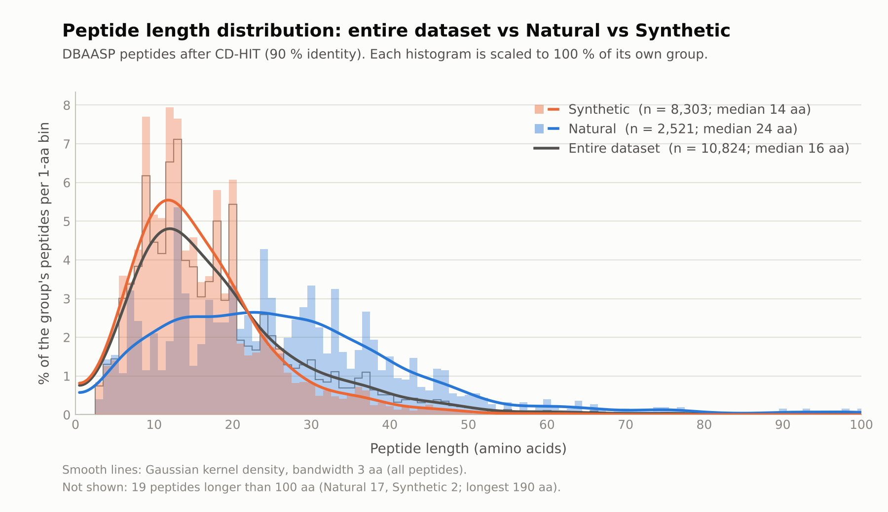
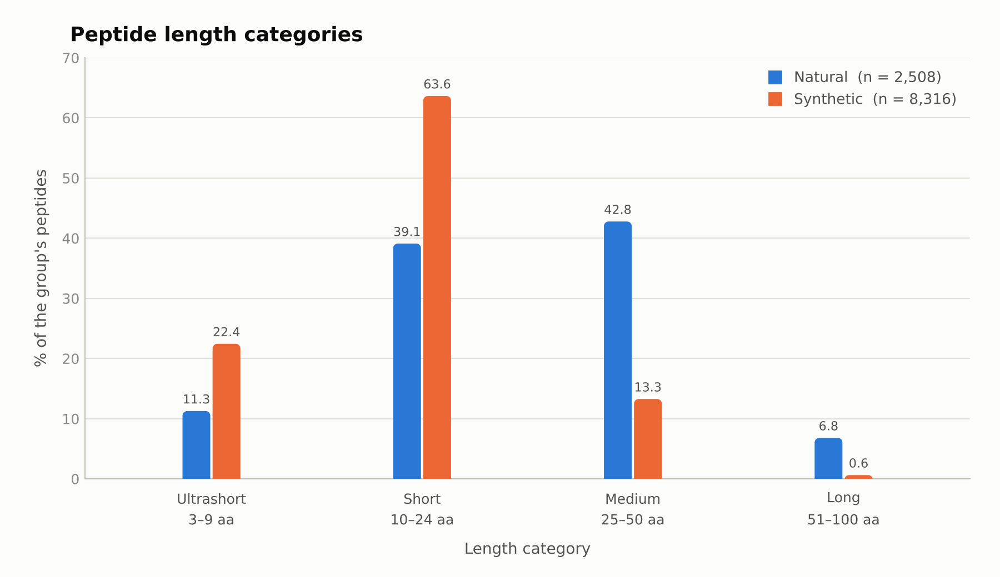
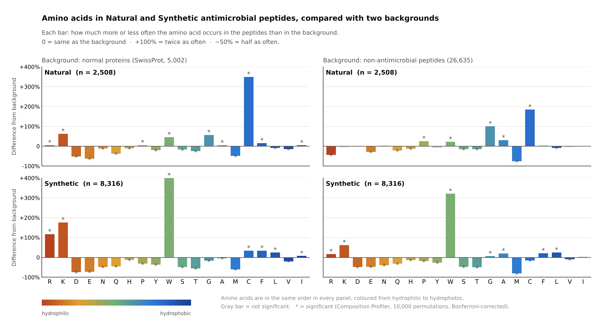

# Deliverables: DBAASP peptides after cleaning and CD-HIT, 90 % identity (Natural + Synthetic)

One FASTA of all Natural and Synthetic peptides after cleaning (X handling, minimum length) and CD-HIT at 90 % identity, the exact
count of sequences lost on the way, the length figures, and the amino acid enrichment of the two datasets against SwissProt.
Everything here is rebuilt from `../raw_data/dbaasp_datasets_corrected.zip` by the five scripts in `scripts/`. Nothing outside
this folder is read or changed except that zip (and, for steps 4 and 5, the installed `cprofiler` package).

```
deliverables/
  fasta/amp_cdhit90.fasta                 10,824 peptides (Natural + Synthetic), ">DBAASP_<ID>" + one-line upper-case sequence
  fasta/amp_natural_cdhit90.fasta         the 2,521 Natural peptides of that file
  fasta/amp_synthetic_cdhit90.fasta       the 8,303 Synthetic peptides of that file
  figures/length_histogram_overlap.png         overlapping histograms + smooth lines: entire / Natural / Synthetic (each as % of its group)
  figures/length_histogram_overlap_counts.png  the same with peptide counts
  figures/length_category_fraction_bar.png     share of Natural and Synthetic peptides per length category
  figures/amino_acid_enrichment.png            the 20 amino acids: Natural / Synthetic x two backgrounds in ONE image (same axes, same order)
  sequences_lost.xlsx                     the table of section 1 as a spreadsheet, with a plain-language note for every step
  tables/redundancy_removal_summary.csv   step-by-step counts, Natural / Synthetic / Total
  tables/removed_records.csv              every lost record: why, and which kept peptide covers it (+ identity for CD-HIT)
  tables/x_to_alanine_counts.csv          peptides and residues in which X was changed to Alanine
  tables/peptide_metadata.csv             FASTA ID -> origin, length, length category, sequence
  tables/length_summary.csv               numbers behind the histogram
  tables/length_category_fractions.csv    numbers behind the bar chart
  tables/cdhit_checks.csv                 integrity checks and two what-if runs (section 5)
  tables/aa_enrichment.csv                20 amino acids x Natural/Synthetic x SwissProt/non-AMP: frequencies, % change, p-value, result
  background/swissprot51_5k.fasta         background 1: SwissProt, 5,002 proteins (identical to the tool's own `-D sprot` file)
  background/pepbench_nonamp_background.fasta   background 2: 26,635 non-antimicrobial peptides (PepBench)
  cdhit/                                  CD-HIT input, output, cluster file (.clstr) and log
  scripts/01_remove_redundancy.py  02_make_figures.py  03_check_cdhit_result.py  04_aa_enrichment.py  05_enrichment_figures.py
```

## 0. What changed in this version

* **`X` (non-standard residue)** is no longer kept. Per peptide: if `X` is **30 % or more** of the peptide it is removed (1,214 peptides); below
  that every `X` becomes **Alanine** (2,610 peptides, 4,494 residues, `tables/x_to_alanine_counts.csv`). Peptides made only of `X` were already removed.
  The 30 % cutoff is my choice (`X_MAX_FRACTION` in script 01); the alternative of converting all `X` would keep peptides that are up to 89 % `X`.
* **Minimum length:** a peptide needs at least **3 real (non-`X`) amino acids** (`MIN_REAL`); 775 peptides fall below it, including the
  15 single-residue entries. The check runs before `X` becomes Ala.
* Duplicates are searched **after** `X` -> Ala, because the change can make two peptides identical.
* Amino acid figure: one image with Natural and Synthetic against **two backgrounds** (SwissProt proteins and non-AMP peptides), identical axes, scale and
  amino acid order (hydrophilic -> hydrophobic), colour-coded, with the Composition Profiler's significance marked (section 3).
  Amino acid **groups are no longer tested or drawn**; the Bonferroni correction is now over the 20 amino acids (alpha = 0.05 / 20 = 0.0025).

## 1. Sequences lost

**CD-HIT (>= 90 % identity) removed 6,615 sequences** (760 Natural, 5,855 Synthetic) of the 15,289 it was given (43.3 %).
Counted from the raw DBAASP export, **14,718 of 25,542 rows are lost, 10,824 remain.**

| Step | what is removed | Natural | Synthetic | **Total lost** | left |
|---|---|---|---|---|---|
| 0 | raw rows | | | | 25,542 |
| 1 | exact duplicate row (same entry, same ID, twice) | 406 | 1,594 | 2,000 | 23,542 |
| 2 | multi-chain entry (several chains in one cell, length not reliable) | 97 | 538 | 635 | 22,907 |
| 3 | sequence made only of `X` | 27 | 321 | 348 | 22,559 |
| 4 | **fewer than 3 real (non-`X`) amino acids** | 197 | 578 | 775 | 21,784 |
| 5 | **`X` is >= 30 % of the peptide** | 261 | 953 | 1,214 | 20,570 |
| | (remaining `X` -> Ala: 331 Natural + 2,279 Synthetic peptides, no loss) | | | | |
| 6 | duplicate sequence within the same origin (after X -> Ala) | 224 | 2,786 | 3,010 | 17,560 |
| 7 | same sequence in Natural and in Synthetic (Natural entry kept) | 0 | 121 | 121 | 17,439 |
| 8 | **CD-HIT, >= 90 % identity** | **760** | **5,855** | **6,615** | **10,824** |
| | **final** | **2,521** | **8,303** | | |

Steps 1 to 3 and 6 are the existing cleaning of `scripts/01_clean_datasets.py`. Step 1 removes repeated rows of the same entry, so it is not a
loss of distinct peptides: of the 23,542 distinct entries, 12,718 are lost. Because the new steps 4 and 5 run before the duplicate search,
the duplicate steps find fewer duplicates than before (3,010 + 121 instead of 3,853 + 167), because many duplicates were already removed with the
`X` and short peptides. Step counts are therefore not comparable one to one with the previous version (which kept 11,804).

CD-HIT arithmetic: 17,439 peptides enter step 8. 2,150 of them are shorter than 10 aa and skip CD-HIT (section 4).
The other 15,289 go in, 8,674 representatives come out, 6,615 are removed. 8,674 + 2,150 = 10,824.

## 2. Length figures




| | Natural | Synthetic | Entire |
|---|---|---|---|
| n | 2,521 | 8,303 | 10,824 |
| median / mean length (aa) | 24 / 27.5 | 14 / 16.1 | 16 / 18.8 |
| Q1 to Q3 | 15 to 35 | 10 to 20 | 11 to 23 |

| Share of group in category | Natural | Synthetic |
|---|---|---|
| Ultrashort 3-9 aa | 11.2 % | 22.5 % |
| Short 10-24 aa | 38.8 % | **63.7 %** |
| Medium 25-50 aa | **42.6 %** | 13.2 % |
| Long 51-100 aa | 6.7 % | 0.6 % |
| > 100 aa | 0.7 % | 0.02 % |

No peptide is shorter than 3 aa any more (so the "1 aa" and "2 aa" categories are empty and no longer drawn). Natural peptides are longer
(median 24 vs 14 aa) and make up most of the Long (170 of 217) and > 100 aa (17 of 19) peptides. Synthetic peptides sit mostly in the Short class.
The Synthetic histogram has sharp spikes (e.g. 659 peptides at 12 aa, 504 at 20 aa but 260 at 19 aa; also 9, 13 and 18 aa), probably convenient design lengths.
The length figures carry no significance marks (the Composition Profiler gives p-values for composition only).

## 3. Amino acid enrichment, against two backgrounds

How much more or less often each amino acid occurs in the antimicrobial peptides (Natural and Synthetic) than in a background set.
Two backgrounds are used, because they answer different questions:

| Background | What it is | Question it answers |
|---|---|---|
| **SwissProt** (`background/swissprot51_5k.fasta`) | 5,002 normal proteins, mostly long (mean about 360 aa) | How do antimicrobial peptides differ from ordinary proteins? |
| **Non-AMP** (`background/pepbench_nonamp_background.fasta`) | 26,635 non-antimicrobial peptides from PepBench, 2-50 aa (median 18) | How do antimicrobial peptides differ from peptides of similar length that are *not* antimicrobial? |



**How to read the figure.** Every bar is the difference from the background in percent: **0 = same as the background, +100 % = twice as often,
-50 % = half as often.** (The axis is a plain linear percentage; the Composition Profiler's own "effect" is this number divided by 100.)
**Why a linear percentage axis.** This is the quantity the Composition Profiler itself plots (its bar plot shows the fractional difference
(query - background) / background on a linear axis, with bootstrap error bars; Vacic et al. 2007, BMC Bioinformatics 8:211, doi:10.1186/1471-2105-8-211),
and it is what the first analysis of this project (`scripts/06_run_composition_profiler.py`) plotted. The first deliverables figure (Oct 14) used a log2 fold-change axis
(0.25x ... 4x) instead; that was a design choice of that version, not a project or tool standard, and it has been replaced. One property to keep in mind:
a percentage is not symmetric, depletion stops at -100 % while enrichment has no limit, so +300 % (4x) and -75 % (0.25x) are the same size of change on a log axis.
The four panels share the same axes and the same amino acid order, so they can be compared directly: rows are Natural and Synthetic, columns are the two backgrounds.
The amino acids are in the Composition Profiler's Kyte-Doolittle order, hydrophilic (R) to hydrophobic (I), and coloured along it.
**Gray bar = not significant; `*` = significant.**

**Method** (`scripts/04_aa_enrichment.py` computes, `scripts/05_enrichment_figures.py` draws)
* Tool: the official Composition Profiler, https://github.com/vvacic/cprofiler (v2.0), the same functions as `cprof discover`; only the 20 amino acids are tested.
* Queries: `fasta/amp_natural_cdhit90.fasta` (2,521 peptides, 69,411 residues) and `fasta/amp_synthetic_cdhit90.fasta` (8,303 peptides, 133,978 residues).
  They contain no `X` any more.
* Backgrounds: SwissProt (release 51 sample, 1,799,466 residues) and the non-AMP peptides (540,735 residues, used as supplied: only the 20 standard letters occur).
* Effect = (frequency in the peptides - frequency in the background) / frequency in the background, residues pooled over all sequences.
* p-value: 10,000 random relabelings of whole sequences between peptides and background, two-tailed, so the smallest value is 1 / 10,000.
  Significant = p < 0.05 / 20 = 0.0025 (Bonferroni over the 20 amino acids). The seed is fixed, so a re-run gives the same table.
* `tables/aa_enrichment.csv` has the frequencies, % change, fold change, p-value and result for every combination.

**Difference from the background, in %** (ns = not significant)

| Amino acid | SwissProt, % of residues | Non-AMP, % of residues | Natural vs SwissProt | Synthetic vs SwissProt | Natural vs non-AMP | Synthetic vs non-AMP |
|---|---|---|---|---|---|---|
| R | 5.45 | 10.12 | +5% | +117% | -43% | +17% |
| K | 5.96 | 10.15 | +62% | +177% | -5% (ns) | +62% |
| D | 5.36 | 2.63 | -52% | -75% | -1% (ns) | -49% |
| E | 6.68 | 3.49 | -62% | -73% | -27% | -48% |
| N | 4.12 | 3.53 | -11% | -49% | +4% (ns) | -40% |
| Q | 3.91 | 3.12 | -36% | -46% | -19% | -32% |
| H | 2.30 | 2.34 | -10% | -13% | -11% | -14% |
| P | 4.77 | 4.01 | +5% | -32% | +26% | -19% |
| Y | 3.06 | 2.66 | -19% | -36% | -7% (ns) | -27% |
| W | 1.15 | 1.36 | +44% | +401% | +21% | +322% |
| S | 6.74 | 6.56 | -16% | -49% | -14% | -48% |
| T | 5.32 | 4.68 | -24% | -56% | -14% | -50% |
| G | 6.97 | 5.46 | +57% | -17% | +101% | +6% |
| A | 7.91 | 6.33 | +4% (ns) | -4% | +30% | +20% |
| M | 2.39 | 4.95 | -48% | -61% | -75% | -81% |
| C | 1.50 | 2.36 | +345% | +34% | +182% | -15% |
| F | 3.98 | 4.41 | +14% | +34% | +3% (ns) | +21% |
| L | 9.71 | 9.70 | -9% | +25% | -9% | +25% |
| V | 6.76 | 5.99 | -14% | -20% | -3% (ns) | -10% |
| I | 5.98 | 6.16 | +3% (ns) | +7% | +0% (ns) | +4% |

**What it shows**
* **Against ordinary proteins (SwissProt), both datasets look like antimicrobial peptides:** more K, R and W, much less D and E.
  Synthetic peptides push this much further: Trp +401 %, Lys +177 %, Arg +117 %. Natural peptides: Lys +62 %, Trp +44 %, Arg only +5 %.
* **Natural peptides are marked by Cys and Gly:** Cys +345 % and Gly +57 % vs SwissProt (consistent with disulfide-rich peptides such as defensins).
  In Synthetic peptides Cys is +34 % and Gly -17 %.
* **Against non-AMP peptides, the picture changes, and that is the more specific result.**
  The non-AMP peptides are themselves rich in K and R (about 10 % of residues each, against 6 % in SwissProt), so charge alone no longer separates the groups:
  Natural peptides have *less* Arg (-43 %) and the same Lys (-5 %, ns); only Synthetic peptides keep a Lys excess (+62 %).
  What stays is **Trp** (Synthetic +322 %, Natural +21 %), the low **Asp/Glu** (Synthetic -49 % / -48 %), low **Met** in both (-75 % / -81 %),
  and for Natural the **Cys (+182 %) and Gly (+101 %)** excess.
* **The two datasets go in opposite directions against both backgrounds** for Gly (Natural +57 % / +101 %, Synthetic -17 % / +6 %), Pro (+5 % / +26 % vs -32 % / -19 %)
  and Cys against non-AMP (+182 % vs -15 %): differences that say something about origin.
* **Read the size of the bar, not the star.** With thousands of peptides almost everything is significant. Not significant (gray):
  SwissProt: A and I in Natural. Non-AMP, Natural: D, F, I, K, N, V, Y. Bars within about +-10 % are negligible whatever the star says.

**Limits**
* **`X` became Ala in some peptides, which inflates Alanine.** 0.8 % of the Natural and 2.9 % of the Synthetic residues are Ala only because they were `X`.
  Against SwissProt the Synthetic Ala bar (-4 %) would be about -40 % without them, and the other 19 amino acids are slightly diluted by the same amount. Read the Ala bars with this in mind.
* **SwissProt is a background of normal, mostly long proteins**; "enriched" there means "different from a typical protein", not "different from a random peptide".
  The release is old (51) and the sample small (5,002 proteins). The earlier check that removed 12 AMP-named proteins from it changed no result (largest effect change 0.006),
  and the non-AMP background now answers the same question more directly, so that table is no longer produced.
* **The non-AMP set is as supplied** (PepBench). I have not checked how it was built (for example whether it was matched to the AMPs by length or composition);
  its high K and R content suggests it contains hard, charge-matched negatives. Results against it depend on that choice.
* Residues are pooled, so long peptides weigh more than short ones, and Natural and Synthetic differ in length; there is no length adjustment.
  D-amino acids count as their L form (the FASTA is upper case).

**Check of the delivered FASTA files** (independent of the scripts): 10,824 / 2,521 / 8,303 sequences in the combined / Natural / Synthetic files, as claimed;
IDs and sequences unique; only the 20 standard letters, no `X`; length 3 to 190 aa; every entry matches its row of the raw data (origin and sequence, with `X` -> `A`);
Natural + Synthetic = combined with no overlap; none of the 6,615 CD-HIT-removed IDs is in the files; the 8,674 CD-HIT output sequences plus the 2,150 peptides shorter than 10 aa equal the final files;
14,718 removed + 10,824 kept = 25,542 raw rows.

## 4. Method (CD-HIT)

```
cd-hit -i input_ge10aa.fasta -o cdhit_ge10aa.fasta -c 0.9 -n 5 -d 0 -l 9 -M 0 -T 1
```
* `-c 0.9 -n 5`: 90 % identity, word size 5, as in the rest of the repository. cd-hit keeps the longest peptide of each cluster.
* **Natural and Synthetic are clustered together**, so the 90 % cut-off applies across both groups, not within each one. When the same sequence
  is in both groups, the Natural entry is kept.
* **Peptides shorter than 10 aa are not sent to CD-HIT**, the existing rule of `scripts/02_run_cdhit.py`.
* **`-l 9` matters.** cd-hit's default `-l 10` silently discards every sequence of 10 aa or fewer. The script checks that
  cd-hit read exactly as many sequences as it was sent (15,289), and stops if not.
* `-T 1`: one thread, so the result is reproducible. The output is byte-identical on re-run.
* FASTA headers use the DBAASP ID (`>DBAASP_11`), not a running number, so every entry can be traced back to the database.
  Sequences are upper case (D-amino acids are lower case in the csv files); `X` no longer occurs (removed or changed to Ala, section 0).
  Origin is not in the header: use the two per-origin files (same records, same headers, same order as the combined file)
  or `tables/peptide_metadata.csv`.

## 5. Things to know

1. **The earlier CD-HIT step undercounts 10-aa peptides.** `scripts/02_run_cdhit.py` sent peptides >= 10 aa to cd-hit with the
   default `-l 10`, which discards 10-aa sequences. `cdhit/by_origin/*/cdhit.log` shows it: Natural "total seq: 3012" although 3,099
   were sent, Synthetic 12,029 of 12,818. So 87 + 789 = 876 ten-aa peptides were dropped and counted as "removed by CD-HIT"
   (section 4 of the main README: 775 / 6,042 removed, 2,797 / 9,092 kept). Clustered per origin with the fix, the result would be
   2,881 / 9,665. These deliverables do not have the problem. The existing scripts, tables and analyses were left as they were.
2. **Combined vs separate clustering.** Clustering together removed 1,673 Synthetic peptides because a Natural peptide covers
   them, and 132 Natural ones because a Synthetic peptide does. Clustering each origin on its own (the old way) would keep
   11,503 peptides (2,611 / 8,892) but the FASTA would still hold Natural/Synthetic near-duplicates. The medians do not change
   (Natural 24, Synthetic 14 either way), so the length conclusions do not depend on this choice.
3. **CD-HIT is greedy**, so which peptide is kept depends a little on the input order (in a test on the previous version of the dataset, a different input order moved the
   separate-clustering numbers by 3 and 6 peptides). The deliverable numbers are for the input order of script 01 and are reproducible.
4. **Peptides of 5-9 aa are not clustered.** Two different peptides of up to 9 aa cannot be 90 % identical, but a short peptide
   can be an exact fragment of a longer one. If the 5-9 aa peptides are clustered too (cd-hit cannot read anything under 5 aa),
   **456 more are removed** (448 Synthetic, 8 Natural), leaving 10,368. The final FASTA has 1,929 peptides of 5-9 aa,
   221 of 3-4 aa and none shorter.
5. **No peptide is shorter than 3 aa** in the final set (the 15 single-amino-acid entries of the earlier version and all 2-aa peptides
   with fewer than 3 real residues are gone, step 4). Peptides of 3-9 aa are kept; the "Ultrashort" class is therefore 3-9 aa here.
6. **Length categories** follow the `Length_Class` column of the data (all 10,824 agree). The data labels the class "Long (50-100 aa)", but
   50-aa peptides are in Medium; Long is 51-100 aa and is labelled so here.
7. **The histogram axis stops at 100 aa**; the 19 longer peptides (17 Natural, 2 Synthetic, longest 190 aa) are named in the
   figure footnote and are in the tables. The overlapping histograms are scaled to 100 % of their own group, because Natural
   (2,521) is much smaller than Synthetic (8,303); the counts version is `length_histogram_overlap_counts.png`.
   The smooth lines are a Gaussian kernel density with a 3 aa bandwidth, mirrored at the 1 aa edge, using all peptides
   (also those over 100 aa). Each line has an area of 100 %, so it is on the same scale as the bars. The wider the
   bandwidth, the more the design-length spikes are averaged out; the bars underneath still show them.

## 6. Reproduce

```bash
pip install pandas matplotlib numpy
sudo apt-get install cd-hit                 # or: conda install -c bioconda cd-hit   (tested with 4.8.1)
git clone https://github.com/vvacic/cprofiler && pip install -e cprofiler     # -e is required (the data folder is not shipped otherwise)
python deliverables/scripts/01_remove_redundancy.py
python deliverables/scripts/02_make_figures.py
python deliverables/scripts/03_check_cdhit_result.py      # optional: checks and what-ifs
python deliverables/scripts/04_aa_enrichment.py           # about 1 minute (4 x 10,000 permutations); writes the table
python deliverables/scripts/05_enrichment_figures.py      # draws the enrichment figure from the table
```
`tables/removed_records.csv` columns: `STEP` (as in the table above), `COVERED_BY` (kept peptide with the same or a >= 90 % identical
sequence, for steps 1, 6, 7 and 8), `IDENTITY_%` (CD-HIT only).
