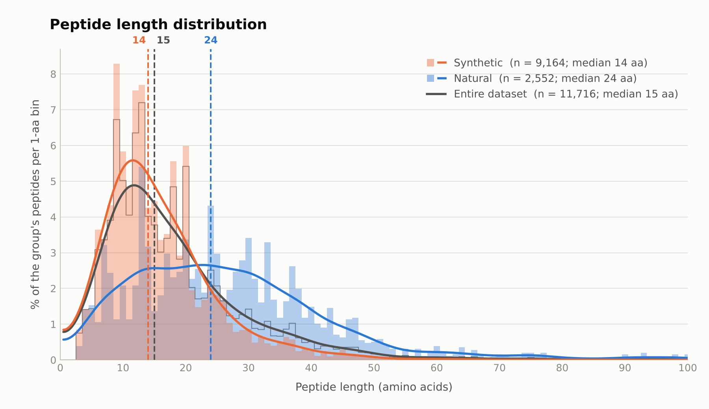
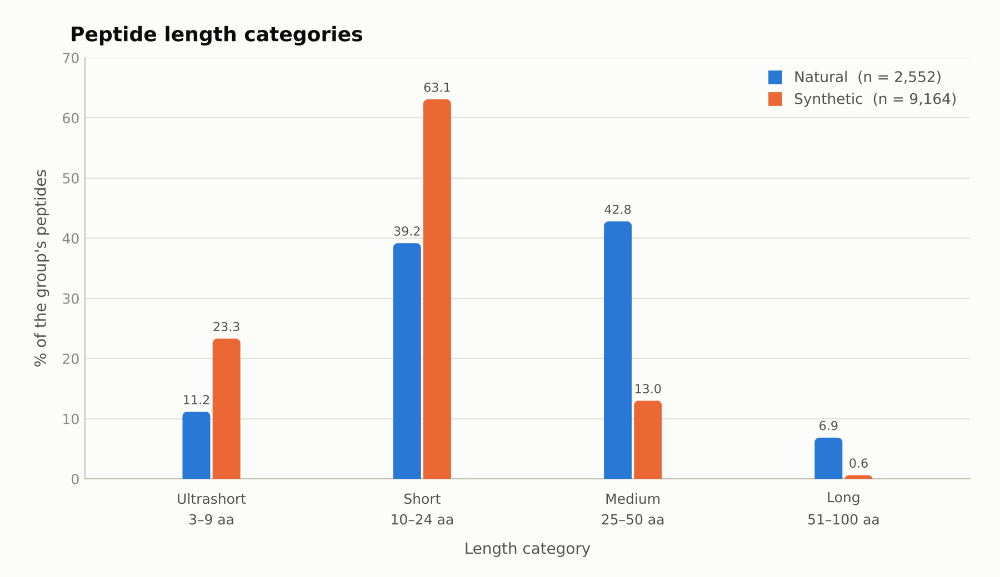
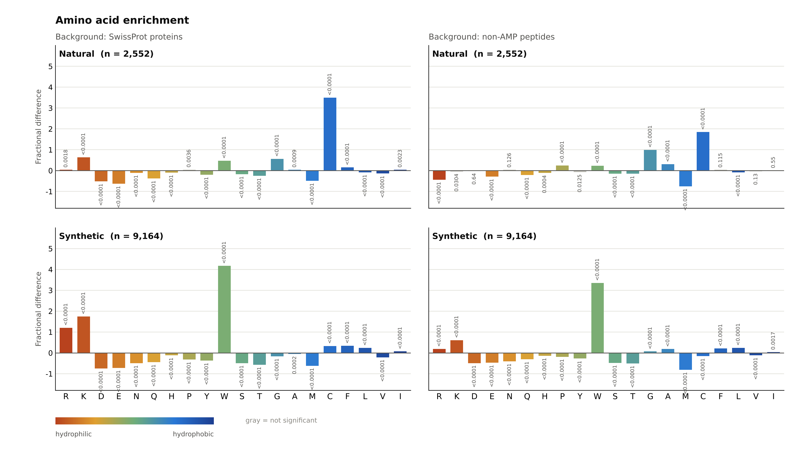

# Deliverables: DBAASP peptides after cleaning and CD-HIT, 90 % identity (Natural + Synthetic)

One FASTA of all Natural and Synthetic peptides after cleaning (X handling, length limits) and CD-HIT at 90 % identity, the exact
count of sequences lost on the way, the length figures, and the amino acid enrichment of the two datasets against two backgrounds.
Everything here is rebuilt from `../raw_data/dbaasp_datasets_corrected.zip` by the six scripts in `scripts/`. Nothing outside
this folder is read or changed except that zip (and, for step 4, the installed `cprofiler` package).
The zip itself is built from the DBAASP export by `../data collection/build_subsets.py`.

```
deliverables/
  fasta/amp_cdhit90.fasta                 11,716 peptides (Natural + Synthetic), ">DBAASP_<ID>" + one-line upper-case sequence
  fasta/amp_natural_cdhit90.fasta         the 2,552 Natural peptides of that file
  fasta/amp_synthetic_cdhit90.fasta       the 9,164 Synthetic peptides of that file
  figures/length_histogram_overlap.png         overlapping histograms + smooth lines: entire / Natural / Synthetic (each as % of its group)
  figures/length_histogram_overlap_counts.png  the same with peptide counts
  figures/length_category_fraction_bar.png     share of Natural and Synthetic peptides per length category
  figures/amino_acid_enrichment.png            the 20 amino acids: Natural / Synthetic x two backgrounds in ONE image (same axes, same order)
  sequences_lost.xlsx                     the table of section 1 as a spreadsheet, with a plain-language note for every step
  tables/redundancy_removal_summary.csv   step-by-step counts, Natural / Synthetic / Total
  tables/removed_records.csv              every lost record: why, and which kept peptide covers it (+ identity for CD-HIT)
  tables/x_to_alanine_counts.csv          peptides and residues in which X was changed to Alanine
  tables/peptide_metadata.csv             FASTA ID -> origin, length, length category, sequence
  tables/length_summary.csv               numbers behind the histogram
  tables/length_category_fractions.csv    numbers behind the bar chart
  tables/cdhit_checks.csv                 integrity checks and two what-if runs (section 5)
  tables/aa_enrichment.csv                20 amino acids x Natural/Synthetic x SwissProt/non-AMP: frequencies, % change, p-value, result
  background/swissprot51_5k.fasta         background 1: SwissProt, 5,002 proteins (identical to the tool's own `-D sprot` file)
  background/pepbench_nonamp_background.fasta   background 2: 26,635 non-antimicrobial peptides (PepBench)
  cdhit/                                  CD-HIT input, output, cluster file (.clstr) and log
  scripts/01_remove_redundancy.py  02_make_figures.py  03_check_cdhit_result.py  04_aa_enrichment.py  05_enrichment_figures.py
          06_sequences_lost_xlsx.py
```
The same figures for the other classifications (source organism, synthesis type, function, target object) are in [`../class_comparisons/`](../class_comparisons/README.md).

## 0. What changed in this version (November 2026)

* **Complete DBAASP export.** In the earlier export the page `peptides 16000-18000.csv` was a second copy of `peptides 18000-20000.csv`,
  so DBAASP IDs 16253-18252 (2,000 entries) were missing and 2,000 duplicate rows had to be removed. The page was downloaded again;
  the export now has 25,542 rows with 25,542 distinct IDs (4,178 Natural, 21,364 Synthetic) and **no duplicate rows**.
  Re-running the unchanged pipeline gives **11,716 peptides (2,552 Natural, 9,164 Synthetic)** instead of 10,824 (2,508 / 8,316).
  All conclusions below are unchanged; individual numbers moved slightly.
* **`X` (non-standard residue):** per peptide, if `X` is **30 % or more** of the peptide it is removed (1,293 peptides); below
  that every `X` becomes **Alanine** (2,832 peptides, 4,969 residues at that step, `tables/x_to_alanine_counts.csv`). Peptides made only of `X` are removed earlier.
  **In the delivered files 1,172 peptides (262 Natural, 910 Synthetic, 10.0 %) carry a former `X`**, 2,170 residues, at most 29 % of a peptide.
  The 30 % cutoff is a choice (`X_MAX_FRACTION` in script 01).
* **Minimum length:** at least **3 real (non-`X`) amino acids** (`MIN_REAL`); 832 peptides fall below it. The check runs before `X` becomes Ala.
* **Maximum length:** peptides **longer than 100 aa are removed** (`MAX_LEN`; 21 peptides, 18 Natural and 3 Synthetic). The final files hold peptides of 3 to 100 aa.
* Duplicates are searched **after** `X` -> Ala, because the change can make two peptides identical.
* Enrichment: only the 20 amino acids (no groups), Bonferroni over 20 tests (alpha = 0.05 / 20 = 0.0025), two backgrounds.

## 1. Sequences lost

**CD-HIT (>= 90 % identity) removed 7,246 sequences** (777 Natural, 6,469 Synthetic) of the 16,541 it was given (43.8 %).
Counted from the raw DBAASP export, **13,826 of 25,542 rows are lost, 11,716 remain.**

| Step | what is removed | Natural | Synthetic | **Total lost** | left |
|---|---|---|---|---|---|
| 0 | raw rows | | | | 25,542 |
| 1 | exact duplicate row | 0 | 0 | 0 | 25,542 |
| 2 | multi-chain entry (several chains in one cell, length not reliable) | 102 | 573 | 675 | 24,867 |
| 3 | sequence made only of `X` | 27 | 332 | 359 | 24,508 |
| 4 | **fewer than 3 real (non-`X`) amino acids** | 199 | 633 | 832 | 23,676 |
| 5 | **longer than 100 aa** | 18 | 3 | 21 | 23,655 |
| 6 | **`X` is >= 30 % of the peptide** | 265 | 1,028 | 1,293 | 22,362 |
| | (remaining `X` -> Ala: 339 Natural + 2,493 Synthetic peptides, no loss) | | | | |
| 7 | duplicate sequence within the same origin (after X -> Ala) | 238 | 3,036 | 3,274 | 19,088 |
| 8 | same sequence in Natural and in Synthetic (Natural entry kept) | 0 | 126 | 126 | 18,962 |
| 9 | **CD-HIT, >= 90 % identity** | **777** | **6,469** | **7,246** | **11,716** |
| | **final** | **2,552** | **9,164** | | |

CD-HIT arithmetic: 18,962 peptides enter step 9. 2,421 of them are shorter than 10 aa and skip CD-HIT (section 4).
The other 16,541 go in, 9,295 representatives come out, 7,246 are removed. 9,295 + 2,421 = 11,716.
Of the cleaned peptides entering step 9, CD-HIT removed 23 % of the Natural (777 of 3,329) and 41 % of the Synthetic ones (6,469 of 15,633):
synthetic libraries are full of single-substitution analogues of a few parent peptides.

## 2. Length figures




| | Natural | Synthetic | Entire |
|---|---|---|---|
| n | 2,552 | 9,164 | 11,716 |
| median / mean length (aa) | 24 / 26.9 | 14 / 16.0 | 15 / 18.4 |
| Q1 to Q3 | 14 to 35 | 10 to 20 | 10 to 23 |

| Share of group in category | Natural | Synthetic |
|---|---|---|
| Ultrashort 3-9 aa | 11.2 % | 23.3 % |
| Short 10-24 aa | 39.2 % | **63.1 %** |
| Medium 25-50 aa | **42.8 %** | 13.0 % |
| Long 51-100 aa | 6.9 % | 0.6 % |

Natural peptides are longer (median 24 vs 14 aa) and make up most of the Long peptides (175 of 232). Synthetic peptides sit mostly in the Short class.
The Synthetic histogram has sharp spikes (e.g. 691 peptides at 12 aa and 705 at 13 aa but 445 at 11 aa; 549 at 20 aa but 267 at 19 aa; also 9 and 18 aa), probably convenient design lengths.
The length figures carry no significance marks (the Composition Profiler gives p-values for composition only).

## 3. Amino acid enrichment, against two backgrounds

| Background | What it is | Question it answers |
|---|---|---|
| **SwissProt** (`background/swissprot51_5k.fasta`) | 5,002 normal proteins, mostly long (mean about 360 aa) | How do antimicrobial peptides differ from ordinary proteins? |
| **Non-AMP** (`background/pepbench_nonamp_background.fasta`) | 26,635 non-antimicrobial peptides from PepBench, 2-50 aa (median 18) | How do antimicrobial peptides differ from peptides of similar length that are *not* antimicrobial? |



**How to read the figure.** Every bar is the **fractional difference** from the background, (peptides - background) / background: **0 = same as the background,
1 = twice as often, -0.5 = half as often.** The number at each bar is the Composition Profiler's p-value ("<0.0001" = no random relabeling reached the observed difference).
The four panels share the same axes and amino acid order: rows are Natural and Synthetic, columns are the two backgrounds.
The amino acids are in Kyte-Doolittle order, hydrophilic (R) to hydrophobic (I), and coloured along it. Gray bar = not significant.
This is the quantity the Composition Profiler itself plots (Vacic et al. 2007, BMC Bioinformatics 8:211, doi:10.1186/1471-2105-8-211).
Depletion stops at -1 while enrichment has no limit, so a 4x increase (+3) and a 4x decrease (-0.75) look unequal.

**Method** (`scripts/04_aa_enrichment.py` computes, `scripts/05_enrichment_figures.py` draws)
* Tool: the official Composition Profiler, https://github.com/vvacic/cprofiler (v2.0), the same functions as `cprof discover`; only the 20 amino acids are tested.
* Queries: `fasta/amp_natural_cdhit90.fasta` (2,552 peptides, 68,619 residues) and `fasta/amp_synthetic_cdhit90.fasta` (9,164 peptides, 146,765 residues). No `X`.
* Backgrounds: SwissProt (release 51 sample, 1,799,466 residues) and the non-AMP peptides (540,735 residues, used as supplied).
* Effect = (frequency in the peptides - frequency in the background) / frequency in the background, residues pooled over all sequences.
* p-value: 10,000 random relabelings of whole sequences between peptides and background, two-tailed, so the smallest value is 1 / 10,000.
  Significant = p < 0.05 / 20 = 0.0025. The seed is fixed, so a re-run gives the same table.

**Fractional difference from the background** (ns = not significant; p-values are in the figure and in the csv)

| Amino acid | SwissProt, % of residues | Non-AMP, % of residues | Natural vs SwissProt | Synthetic vs SwissProt | Natural vs non-AMP | Synthetic vs non-AMP |
|---|---|---|---|---|---|---|
| R | 5.45 | 10.12 | +0.04 | +1.20 | -0.44 | +0.19 |
| K | 5.96 | 10.15 | +0.63 | +1.74 | -0.04 (ns) | +0.61 |
| D | 5.36 | 2.63 | -0.52 | -0.75 | -0.02 (ns) | -0.49 |
| E | 6.68 | 3.49 | -0.63 | -0.73 | -0.29 | -0.47 |
| N | 4.12 | 3.53 | -0.11 | -0.49 | +0.04 (ns) | -0.40 |
| Q | 3.91 | 3.12 | -0.37 | -0.45 | -0.21 | -0.31 |
| H | 2.30 | 2.34 | -0.10 | -0.12 | -0.12 | -0.14 |
| P | 4.77 | 4.01 | +0.05 (ns) | -0.32 | +0.25 | -0.19 |
| Y | 3.06 | 2.66 | -0.20 | -0.37 | -0.08 (ns) | -0.27 |
| W | 1.15 | 1.36 | +0.47 | +4.17 | +0.24 | +3.35 |
| S | 6.74 | 6.56 | -0.17 | -0.49 | -0.15 | -0.48 |
| T | 5.32 | 4.68 | -0.25 | -0.57 | -0.15 | -0.51 |
| G | 6.97 | 5.46 | +0.56 | -0.16 | +1.00 | +0.07 |
| A | 7.91 | 6.33 | +0.04 | -0.05 | +0.31 | +0.18 |
| M | 2.39 | 4.95 | -0.49 | -0.62 | -0.75 | -0.82 |
| C | 1.50 | 2.36 | +3.49 | +0.33 | +1.85 | -0.16 |
| F | 3.98 | 4.41 | +0.15 | +0.34 | +0.04 (ns) | +0.21 |
| L | 9.71 | 9.70 | -0.09 | +0.24 | -0.08 | +0.24 |
| V | 6.76 | 5.99 | -0.14 | -0.22 | -0.03 (ns) | -0.11 |
| I | 5.98 | 6.16 | +0.04 | +0.07 | +0.01 (ns) | +0.04 |

**What it shows**
* **Against ordinary proteins (SwissProt), both datasets look like antimicrobial peptides:** more K, R and W, much less D and E.
  Synthetic peptides push this much further: Trp +4.17, Lys +1.74, Arg +1.20. Natural peptides: Lys +0.63, Trp +0.47, Arg only +0.04.
* **Natural peptides are marked by Cys and Gly:** Cys +3.49 and Gly +0.56 vs SwissProt (consistent with disulfide-rich peptides such as defensins).
  In Synthetic peptides Cys is +0.33 and Gly -0.16.
* **Against non-AMP peptides, the picture changes, and that is the more specific result.**
  The non-AMP peptides are themselves rich in K and R (about 10 % of residues each, against 6 % in SwissProt), so charge alone no longer separates the groups:
  Natural peptides have *less* Arg (-0.44) and the same Lys (-0.04, ns); only Synthetic peptides keep a Lys excess (+0.61).
  What stays is **Trp** (Synthetic +3.35, Natural +0.24), the low **Asp/Glu** (Synthetic -0.49 / -0.47), low **Met** in both (-0.75 / -0.82),
  and for Natural the **Cys (+1.85) and Gly (+1.00)** excess.
* **The two datasets go in opposite directions** for Gly (Natural +0.56 / +1.00, Synthetic -0.16 / +0.07), Pro (+0.05 ns / +0.25 vs -0.32 / -0.19),
  Leu against SwissProt (-0.09 vs +0.24) and Cys against non-AMP (+1.85 vs -0.16): differences that say something about origin.
* **Read the size of the bar, not the p-value.** With thousands of peptides almost everything is significant. Not significant (gray):
  SwissProt, Natural: P only (A, I and R are just significant, p 0.001-0.002, with differences of +0.04). Non-AMP, Natural: D, F, I, K, N, V, Y; non-AMP, Synthetic: none.
  Differences within about +-0.1 are negligible whatever the p-value says.

**Limits**
* **`X` became Ala in some peptides, which inflates Alanine.** 0.65 % of the Natural and 1.17 % of the Synthetic residues are Ala only because they were `X`.
  Against SwissProt the Synthetic Ala bar (-0.05) would be about -0.19 without them (Natural +0.04 -> -0.03). Read the Ala bars with this in mind.
* **SwissProt is a background of normal, mostly long proteins**; "enriched" there means "different from a typical protein". The release is old (51) and the sample small (5,002 proteins).
* **The non-AMP set is as supplied** (PepBench); how it was built (e.g. matched to AMPs by length or composition) was not checked.
  Its high K and R content suggests charge-matched negatives. Results against it depend on that choice.
* Residues are pooled, so long peptides weigh more than short ones, and Natural and Synthetic differ in length; there is no length adjustment.
  D-amino acids count as their L form (the FASTA is upper case).

## 4. Method (CD-HIT)

```
cd-hit -i input_ge10aa.fasta -o cdhit_ge10aa.fasta -c 0.9 -n 5 -d 0 -l 9 -M 0 -T 1
```
* `-c 0.9 -n 5`: 90 % identity, word size 5. cd-hit keeps the longest peptide of each cluster.
* **Natural and Synthetic are clustered together**, so the 90 % cut-off applies across both groups. When the same sequence is in both groups, the Natural entry is kept.
* **Peptides shorter than 10 aa are not sent to CD-HIT**: two different peptides of up to 9 aa cannot be 90 % identical (one mismatch in 9 = 88.9 %), and identical ones were already removed.
* **`-l 9` matters.** cd-hit's default `-l 10` silently discards every sequence of 10 aa or fewer. The script checks that
  cd-hit read exactly as many sequences as it was sent (16,541), and stops if not. (The first-pass analysis of September 2026 had this problem; it has been removed from the repository.)
* `-T 1`: one thread, so the result is reproducible. Tested with cd-hit 4.8.1.
* FASTA headers use the DBAASP ID (`>DBAASP_11`), so every entry can be traced back to the database.
  Sequences are upper case (D-amino acids are lower case in the csv files); `X` no longer occurs.

## 5. Things to know

1. **Combined vs separate clustering.** Clustering together removed 1,754 Synthetic peptides because a Natural peptide covers
   them, and 136 Natural ones because a Synthetic peptide does. Clustering each origin on its own would keep
   12,418 peptides (2,645 / 9,773) but the FASTA would still hold Natural/Synthetic near-duplicates. The medians do not change
   (Natural 24, Synthetic 14 either way), so the length conclusions do not depend on this choice.
2. **CD-HIT is greedy**, so which peptide is kept depends a little on the input order. The numbers are for the input order of script 01 and are reproducible.
3. **Peptides of 5-9 aa are not clustered.** A short peptide can be an exact fragment of a longer one. If the 5-9 aa peptides are clustered too
   (cd-hit cannot read anything under 5 aa), **512 more are removed** (504 Synthetic, 8 Natural). The final FASTA has 2,168 peptides of 5-9 aa,
   253 of 3-4 aa and none shorter.
4. **Length categories** follow the `Length_Class` column of the data. The data labels the class "Long (50-100 aa)", but
   50-aa peptides are in Medium; Long is 51-100 aa and is labelled so here. "Ultrashort" is 3-9 aa here, because peptides under 3 real residues are removed.
5. **The histograms** are scaled to 100 % of their own group, because Natural (2,552) is much smaller than Synthetic (9,164); the counts version is
   `length_histogram_overlap_counts.png`. The smooth lines are a Gaussian kernel density with a 3 aa bandwidth, mirrored at the 1 aa edge.
6. **Checks** (`tables/cdhit_checks.csv`): every removed peptide has >= 90.2 % identity to a kept representative that is at least as long;
   re-clustering the final >= 10 aa set removes nothing; 13,826 removed + 11,716 kept = 25,542 raw rows.

## 6. Reproduce

```bash
pip install pandas matplotlib numpy openpyxl
sudo apt-get install cd-hit                 # or: conda install -c bioconda cd-hit   (tested with 4.8.1)
git clone https://github.com/vvacic/cprofiler && pip install -e cprofiler     # -e is required (the data folder is not shipped otherwise)
python "data collection/build_subsets.py"                 # only when the export changes: rebuilds raw_data/dbaasp_datasets_corrected.zip
python deliverables/scripts/01_remove_redundancy.py
python deliverables/scripts/02_make_figures.py
python deliverables/scripts/03_check_cdhit_result.py      # optional: checks and what-ifs
python deliverables/scripts/04_aa_enrichment.py           # about 1 minute (4 x 10,000 permutations); writes the table
python deliverables/scripts/05_enrichment_figures.py      # draws the enrichment figure from the table
python deliverables/scripts/06_sequences_lost_xlsx.py     # the loss table as a spreadsheet
```
`tables/removed_records.csv` columns: `STEP` (as in the table above), `COVERED_BY` (kept peptide with the same or a >= 90 % identical
sequence, for steps 7, 8 and 9), `IDENTITY_%` (CD-HIT only).
