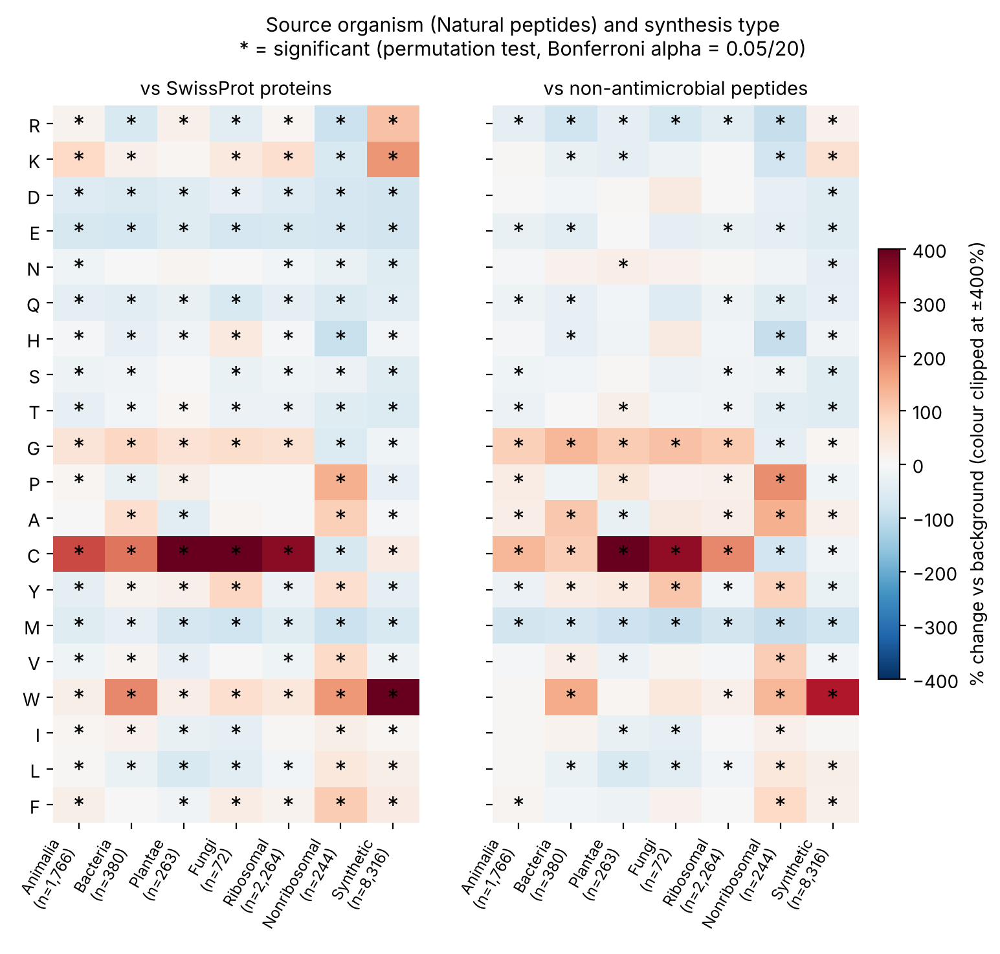
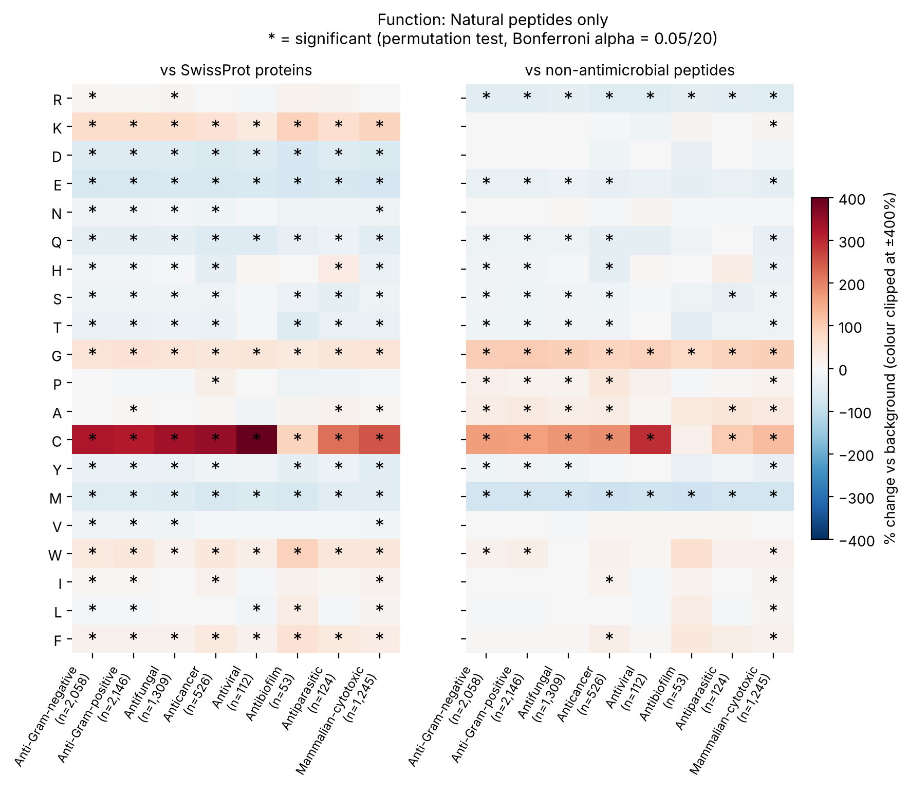
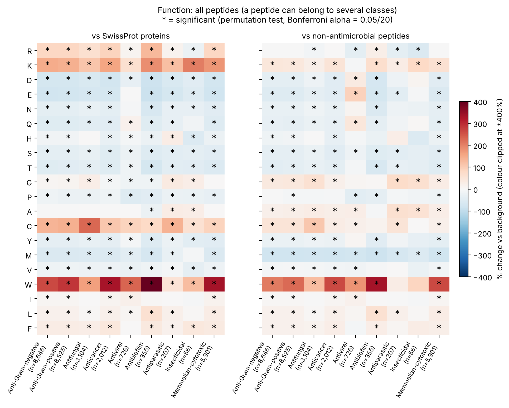
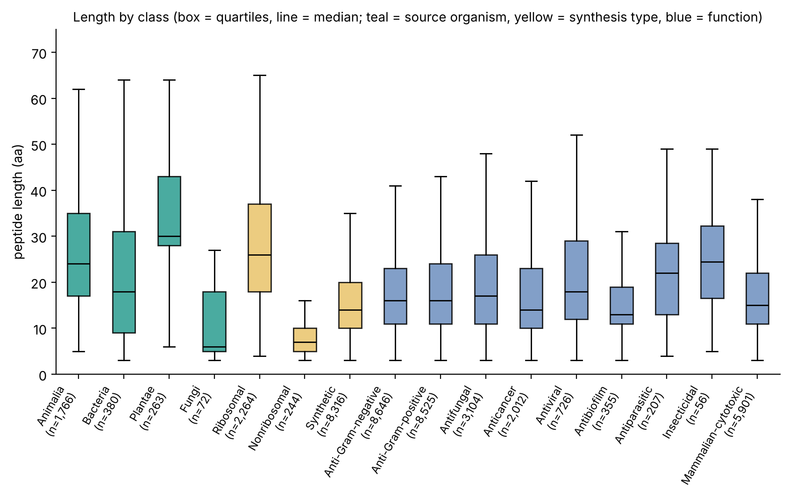
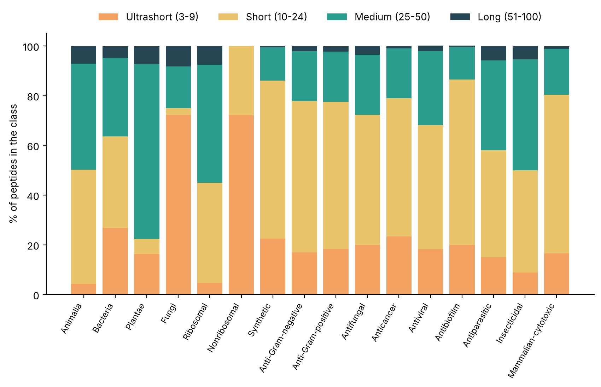

# Survey of antimicrobial peptide classes (source organism, synthesis type, function)

Extends the Natural vs Synthetic analysis of [`deliverables/`](../deliverables/README.md) to the other classifications in the DBAASP data.
Same peptides (the 10,824 after cleaning, X -> Ala, CD-HIT 90 %), same two backgrounds (SwissProt proteins, non-antimicrobial peptides),
same test (Composition Profiler permutation test, Bonferroni alpha = 0.05/20), same amino acid order. No new peptide property is calculated:
all labels are existing DBAASP columns.

```
survey/scripts/   common.py  01_build_survey_table.py  02_survey_enrichment.py  03_survey_length.py  04_survey_figures.py
survey/tables/    survey_peptides.csv            every peptide with its class labels (function as True/False columns)
                  group_sizes.csv                n per class, and whether it is big enough to be tested (n >= 50)
                  survey_aa_enrichment.csv       25 classes x 2 backgrounds x 20 amino acids: frequencies, % change, p-value, result
                  survey_length_summary.csv      n, median, quartiles, mean, % per length category, per class
                  survey_length_tests.csv        each class vs all other peptides of its population (Mann-Whitney, rank-biserial r)
                  function_overlap_jaccard.csv   overlap between the function classes
survey/figures/   enrichment_source_and_synthesis.png  enrichment_function_all.png  enrichment_function_natural.png
                  length_boxplots.png  length_category_share.png  function_overlap.png
```
Run `python survey/scripts/01_...py` to `04_...py` in order (needs `deliverables/` and `by_*/` as in the repository; step 2 takes about 3 minutes).

## Classes and sizes

| Classification | Classes tested (n >= 50) | Not tested (too small) |
|---|---|---|
| Source organism (**Natural peptides only**) | Animalia 1,766 · Bacteria 380 · Plantae 263 · Fungi 72 | Archaea 3 · Protista 2 · two-kingdom 2 · Unclassified 20 |
| Synthesis type | Ribosomal 2,264 · Nonribosomal 244 · Synthetic 8,316 | |
| Function, all peptides | anti-Gram-neg 8,646 · anti-Gram-pos 8,525 · mammalian-cytotoxic 5,901 · antifungal 3,104 · anticancer 2,012 · antiviral 726 · antibiofilm 355 · antiparasitic 207 · insecticidal 56 | antiprotozoal 33 · nematicidal 25 · anti-mollicute 18 |
| Function, **Natural only** | same, without insecticidal (36) | |

Two things shape how to read the survey:

* **Source organism exists only for Natural peptides.** DBAASP marks 8,315 of 8,316 Synthetic peptides as `Unclassified`, so there is no kingdom comparison for them.
* **Function classes overlap** (a peptide has a median of 3 function labels; `function_overlap.png`). The two antibacterial classes are almost the same
  set of peptides. Also, 77 % of all peptides are Synthetic, so the "all peptides" function view mostly shows the synthetic composition.
  That is why every function result is shown twice, for all peptides and for Natural peptides only.

## Amino acid enrichment





What stands out (effects against SwissProt; "also vs non-AMP" = same direction and significant against both backgrounds):

* **Natural peptides share one signature: Cys up, Gly up (also vs non-AMP), Met / Glu / Gln down.** Cys is enriched by +936 % in Plantae, +616 % in Fungi,
  +265 % in Animalia and +216 % in Bacteria. Cys is the disulfide-bond residue; the plant and fungal peptides are the most Cys-rich.
* **Plantae:** Cys, Gly, Pro, Tyr, Thr up; the hydrophobic Met, Leu, Ala, Val, Ile down. **Fungi (n = 72, treat as indicative):** Cys, Tyr, Gly up; Met, Arg, Leu, Ile down.
  **Animalia:** Cys, Gly, Phe, Pro up; Met, Glu, Gln, Tyr, Thr down. **Bacteria:** Cys, Trp, Gly, Ala, Tyr up; Glu, Arg, Gln, His, Met down.
* **Synthetic peptides look different from every natural class:** Trp (+400 %), Lys (+176 %), Arg (+116 %), Phe, Leu up, with almost no Cys. This is the
  cationic-amphipathic design pattern. **Nonribosomal peptides** differ again: Pro (+141 %), Trp, Phe, Ala, Val up, while Arg (-86 %), Lys, His, Cys, Glu are down
  (they are mostly neutral/anionic, short and often cyclic).
* **Function, all peptides:** every class is Trp / Lys / Cys / Phe / Leu up and Glu / Asp / Met / Thr / Gln down, because the synthetic peptides dominate each class.
  Antiviral is the exception (Trp, Cys, Ile, Gln up; Pro, Met, Val, Ser down).
* **Function, Natural only:** the classes mostly share the natural signature (Cys, Gly up; Met, Glu, Gln down), so the amino acid composition separates *source* much
  more than *function*. Differences that remain: anticancer has additional Pro, Ile, Phe up (and His down); mammalian-cytotoxic has Lys, Trp, Phe up;
  antibiofilm (n = 53) and antiparasitic (n = 124) show a weaker Cys signal (not significant for antibiofilm against non-AMP).

## Length




* Medians: Plantae 30 aa · Animalia 24 · Bacteria 18 · **Fungi 6** (72 % are 3-9 aa) · Ribosomal 26 · **Nonribosomal 7** (no peptide above 24 aa) · Synthetic 14.
  Kruskal-Wallis: length differs across the four source organisms (p = 7e-37) and across the synthesis types (p < 1e-300).
* **Function, all peptides:** medians are 13-18 aa for nearly all classes, again the synthetic length. Antiparasitic (22) and insecticidal (24.5) are longer
  than the rest, antibiofilm (13) and anticancer (14) shorter.
* **Function, Natural only:** anticancer peptides are shorter than other natural peptides (median 19 vs 25 aa, r = -0.30, the largest function effect);
  mammalian-cytotoxic is also shorter (23 vs 28, r = -0.13); antifungal, antiviral and antiparasitic do not differ from the other natural peptides.

## Cautions

* With thousands of peptides tiny differences are significant: read the **% change**, not only the star. Fungi, antibiofilm (natural), insecticidal and antiviral (natural) are small samples.
* p = 0 in the table means p < 1/10,000 (10,000 permutations). The length p-values are Bonferroni corrected over all tests in `survey_length_tests.csv`.
* Classes overlap and are not independent, so the heatmap columns must not be read as separate experiments.
* `Unclassified` kingdom is not a biological class; the 20 natural peptides in it are untested.
* **Implementation note:** the `cprofiler` tool could not be installed in this environment, so `02_survey_enrichment.py` runs the same permutation test in numpy.
  It reproduces `deliverables/tables/aa_enrichment.csv` for Synthetic exactly (largest difference in the effect: 0.0; all 80 significance calls agree).
  The exact p-values come from random permutations (fixed seed), so they can differ slightly from a run of the tool.
